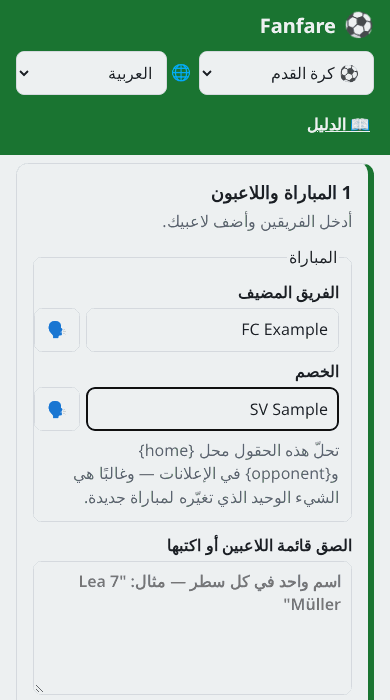
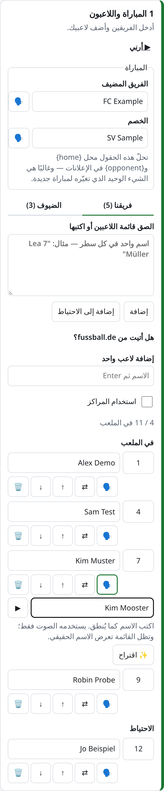
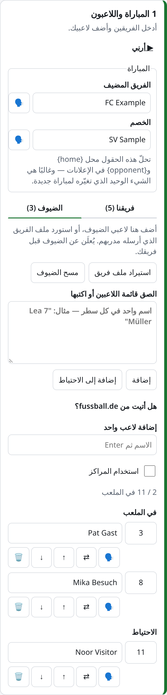
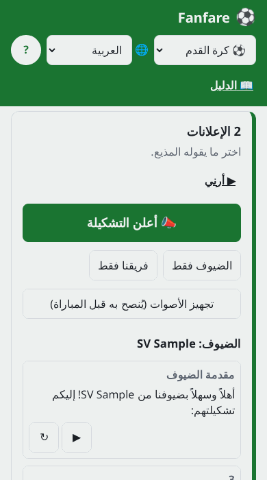
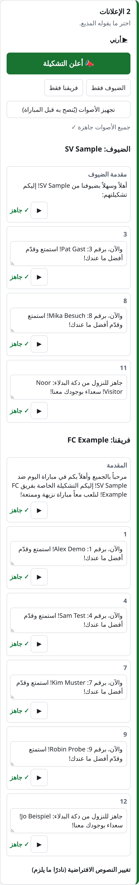
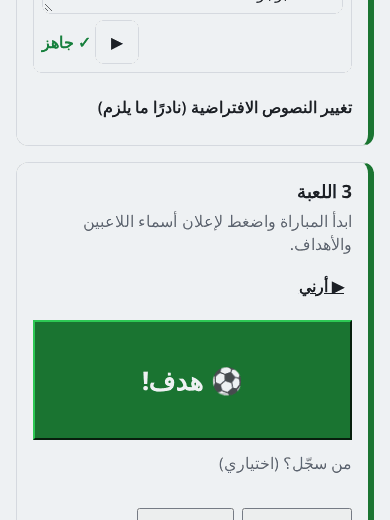
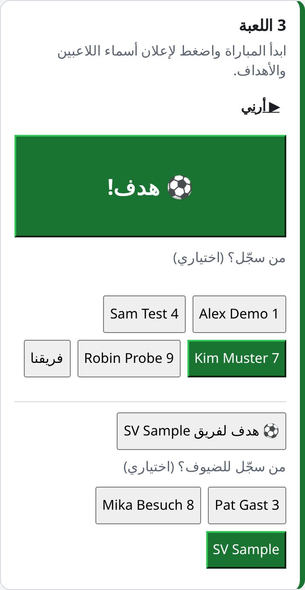
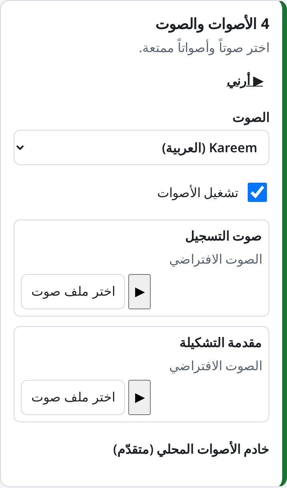
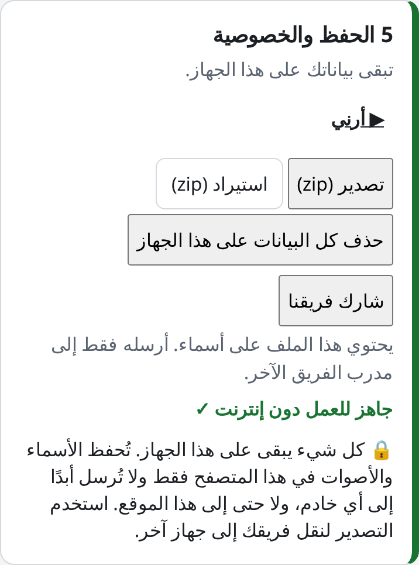

<!-- Translation: machine-assisted — native speakers, please review. -->

# Fanfare: دليل البدء

Fanfare صفحة ويب تعلن عن فريقك كما يفعل مذيع الملعب. تُدخل لاعبيك مرة واحدة. ثم يقرأ صوتٌ التشكيلة وينادي اسم المسجّل بعد كل هدف. يعمل في المتصفح، بلا حساب وبلا تكلفة.

## 1. ما هو Fanfare؟

لدى Fanfare خمس خطوات تحت بعضها: **1 المباراة واللاعبون** و**2 الإعلانات** و**3 اللعبة** و**4 الأصوات والصوت** و**5 الحفظ والخصوصية**. افتح الصفحة على هاتف أو جهاز لوحي، وامضِ من الأعلى إلى الأسفل، وضع الجهاز بجانب مكبّر الصوت. كل شيء يعمل على جهازك. لا يوجد تسجيل ولا خادم يستقبل بياناتك.

## 2. قبل المباراة الأولى

في الأعلى اختر **الرياضة** و**اللغة**. تحدد الرياضة الكلمة على زر النتيجة (هدف، سلة، نقطة) والمراكز المتاحة.

في الخطوة 1 املأ **الفريق المضيف** و**الخصم**. ثم الصق لاعبيك في خانة **الصق قائمة اللاعبين أو اكتبها**، لاعب في كل سطر، ورقم القميص أولًا، مثل `7 Kim Muster`. بزر **إضافة** يظهر اللاعبون في قائمة **في الملعب**. وبزر **إضافة إلى الاحتياط** يذهب البدلاء إلى الاحتياط. لاسم واحد اكتبه في **إضافة لاعب واحد** واضغط Enter.

في كل سطر أزرار صغيرة: **⇄** ينقل اللاعب بين الملعب والاحتياط، و**↑** و**↓** يغيّران الترتيب، و**🗑** يحذف اللاعب (يمكنك التراجع لبضع ثوانٍ). فعّل **استخدام المراكز** إذا أردت أن يقول المذيع أيضًا "حارس المرمى" أو "الوسط".

**🗣 انطقه هكذا…** يحدد كيف يُنطق الاسم. اضغط 🗣 في السطر واكتب الاسم كما يُسمع، مثل `Kim Mooster`. الصوت وحده يستخدم هذا النص. وتبقى القائمة تعرض الاسم الحقيقي. اضغط ▶ لتسمعه. زر 🗣 نفسه موجود بجانب أسماء الفريقين. يمكن لزر **✨ اقتراح** أن يجد لك إملاءً مناسبًا: اختر لغة الاسم، وأدخل إملاءه الأصلي (مثل `Nguyễn`)، فيقترح التطبيق حتى ثلاث كتابات ينطقها الصوت قريبةً من النطق الحقيقي. اضغط ▶ لتسمع كل واحدة، و**استخدم** لاختيارها. يعمل دون اتصال؛ وهو متاح حاليًا للأصوات الألمانية والإنجليزية.

**نصيحة:** إذا كان ناديك يستخدم fussball.de فافتح هناك قائمة **فريقك أنت**، وانسخها والصقها في الخانة. يتم التعرف على أرقام القمصان والأسماء. لا يتصل Fanfare بموقع fussball.de أبدًا. التفاصيل تحت "هل أتيت من fussball.de؟" في الخطوة 1.

**هل تلعبون ضد نادٍ آخر يستخدم Fanfare؟ تبادلوا ملفات الفرق.** في الخطوة 5 اضغط **شارك فريقنا** وأرسل الملف (بالبريد الإلكتروني أو على ذاكرة USB) إلى مدرب الفريق الآخر. يحتوي الملف على أسماء. أرسله فقط إلى مدرب الفريق الآخر. عندما يصلك ملفهم، افتح تبويب **الضيوف** في الخطوة 1، واضغط **استيراد ملف فريق** واختر الملف. يظهر الضيوف في قائمة خاصة بهم ويُملأ اسم الخصم. **مسح الضيوف** يزيلهم مرة أخرى.

## 3. في يوم المباراة

1. في الخطوة 1 أدخل **الخصم**. هذا عادةً الشيء الوحيد الذي يتغير من مباراة إلى أخرى.

2. افتح الخطوة 2 **الإعلانات**. لكل لاعب نص يمكنك قراءته وتعديله وسماعه بزر ▶. سطر **المقدمة** هو نص الترحيب. نادرًا ما يلزم: "تغيير النصوص الافتراضية" في الأسفل يغيّر كل النصوص دفعة واحدة.

3. اضغط **تجهيز الأصوات (يُنصح به قبل المباراة)** ما دام الواي فاي متاحًا. في المرة الأولى يُنزَّل الصوت إلى جهازك، وهذا يستغرق قليلًا. يعرض عدّاد مثل `3 / 6` التقدم. انتظر **جميع الأصوات جاهزة ✓**. بعد ذلك يعمل المذيع حتى بدون إنترنت.

4. عندما يدخل الفريقان الملعب اضغط **📣 أعلن التشكيلة**. يعمل صوت المقدمة أولًا ثم يقرأ الصوت التشكيلة. **إيقاف** ينهي ذلك في أي وقت.

**الضيوف أولاً.** إذا استوردت فريق ضيوف فإن **📣 أعلن التشكيلة** يرحّب بالضيوف ويقرأ تشكيلتهم ثم تشكيلتك. **الضيوف فقط** و**فريقنا فقط** يعلنان فريقاً واحداً فقط. **تحضير الأصوات** يشمل الفريقين. في الخطوة 3 يوجد زر إضافي **هدف لفريق SV Sample** لأهداف الضيوف.

## 4. أثناء المباراة

افتح الخطوة 3 **اللعبة**. الزر الكبير، مثل **⚽ هدف!**، يشغّل صوت الهدف ويعلن الصوت الهدف.

لذكر المسجّل اضغط أولًا على اللاعب تحت الزر، مثل **7 Kim Muster**. يصبح اسمه جزءًا من الإعلان. اضغط عليه مرة أخرى لإلغاء الاختيار، أو اضغط **فريقنا** لهدف بلا اسم. **إيقاف** يقطع الصوت مبكرًا.

## 5. أصواتك وصوتك الخاص

افتح الخطوة 4 **الأصوات والصوت**. هنا يمكنك:

- اختيار **الصوت** (واحد أو أكثر لكل لغة)،
- تشغيل **تشغيل الأصوات** أو إيقافه،
- تحميل صوتك الخاص لـ **صوت التسجيل** أو **مقدمة التشكيلة** بزر **اختر ملف صوت**. بزر ▶ تجربه، وبزر **إعادة إلى الافتراضي** يعود الأصلي. يمكن أن يصل حجم الملفات إلى 10 ميغابايت.

## 6. الحفظ والنقل إلى جهاز آخر والحذف

افتح الخطوة 5 **الحفظ والخصوصية**.

- **تصدير (zip)** يحفظ فريقك وإعداداتك وأصواتك في ملف باسم مثل `fanfare-2026-11-13.zip`.
- **استيراد (zip)** يحمّل ملفًا كهذا على جهاز آخر أو بعد إعادة الضبط. وهو يستبدل ما على الجهاز.
- **حذف كل البيانات على هذا الجهاز** يزيل كل شيء نهائيًا.
- صدّر من وقت لآخر كنسخة احتياطية.

**الخصوصية بكلمات بسيطة:** يبقى فريقك والأسماء والأصوات في هذا المتصفح على هذا الجهاز. لا تُرسل إلى أي خادم، ولا حتى إلى الموقع الذي يستضيف Fanfare. لا تتبّع ولا حساب. الصفحة تتواصل مع عنوانها فقط.

## 7. حل المشكلات

- **لا صوت على iPhone أو iPad:** تأكد أن مفتاح الصامت الجانبي مُغلق وأن مستوى الصوت مرتفع. المس الصفحة أو الزر مرة واحدة ثم اضغط مجددًا. أول صوت بعد فتح الصفحة يحتاج إلى لمسة.
- **تنزيل الصوت بطيء:** يُنزَّل الصوت مرة واحدة فقط. اضغط **تجهيز الأصوات** في البيت مع واي فاي جيد، وليس في الملعب.
- **اختفى الفريق بعد إعادة الفتح:** النافذة الخاصة لا تستطيع حفظ شيء. استخدم نافذة عادية أو **تصدير (zip)** قبل إغلاقها.
- **مكبّر الصوت:** صِل مكبّر صوت بلوتوث أو كابلًا بالجهاز وجرّب بزر ▶ قبل المباراة. أوقف وضع "عدم الإزعاج".
- **المتصفحات:** أحدث إصدارات Chrome أو Edge أو Firefox، وSafari أو iOS 16.4 أو أحدث.

