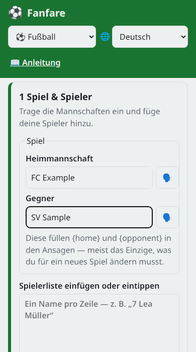
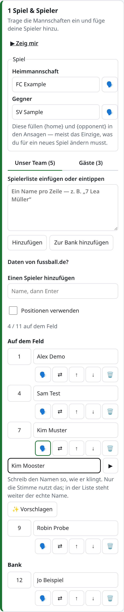
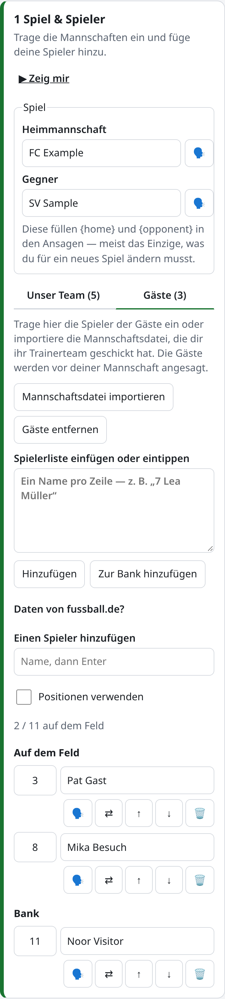
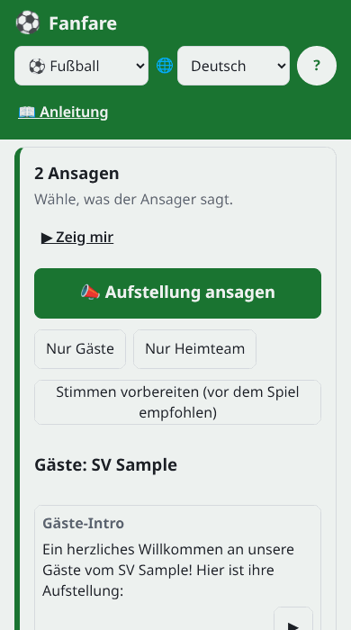
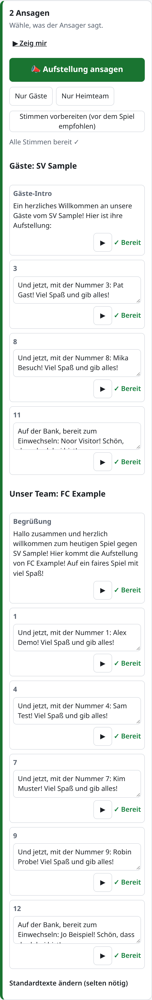
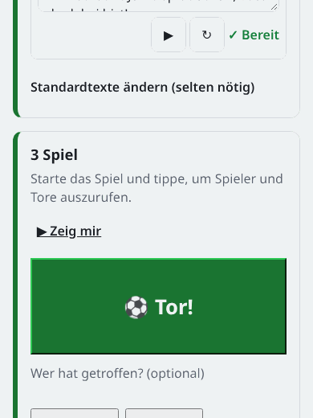
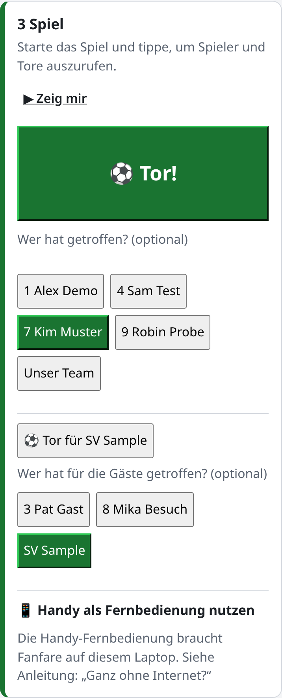
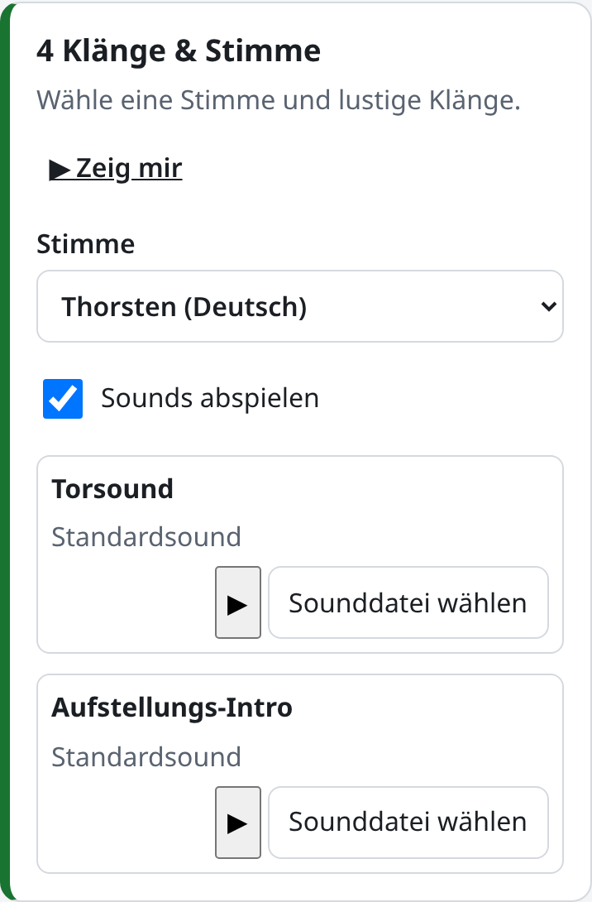

# Fanfare: Kurzanleitung

Fanfare ist eine Webseite, die deine Mannschaft wie ein Stadionsprecher ansagt. Du gibst deine Spieler einmal ein. Eine Stimme liest dann die Aufstellung vor und ruft nach jedem Tor den Torschützen aus. Es läuft im Browser, braucht kein Konto und kostet nichts.

## 1. Was ist Fanfare?

Fanfare hat fünf Schritte untereinander: **1 Spiel & Spieler**, **2 Ansagen**, **3 Spiel**, **4 Klänge & Stimme** und **5 Speichern & Datenschutz**. Öffne die Seite auf Handy oder Tablet, arbeite dich von oben nach unten durch und stelle das Gerät neben den Lautsprecher. Alles läuft auf deinem eigenen Gerät. Es gibt keine Anmeldung und keinen Server, der deine Daten bekommt.

## 2. Vor dem ersten Spiel

Wähle oben deine **Sportart** und deine **Sprache**. Die Sportart bestimmt das Wort auf dem Torknopf (Tor, Korb, Punkt) und die Positionen, die du auswählen kannst.

Trage in Schritt 1 **Heimmannschaft** und **Gegner** ein. Füge dann deine Spieler in das Feld **Spielerliste einfügen oder eintippen** ein, einen pro Zeile, die Rückennummer zuerst, zum Beispiel `7 Kim Muster`. Mit **Hinzufügen** erscheinen die Spieler in der Liste **Auf dem Feld**. Mit **Zur Bank hinzufügen** kommen Ersatzspieler auf die Bank. Einen einzelnen Namen tippst du bei **Einen Spieler hinzufügen** ein und drückst Enter.

Jede Zeile hat kleine Knöpfe: **⇄** schiebt einen Spieler zwischen Feld und Bank, **↑** und **↓** ändern die Reihenfolge, **🗑** entfernt den Spieler (für ein paar Sekunden kannst du das rückgängig machen). Setze den Haken bei **Positionen verwenden**, wenn der Sprecher auch "Torwart" oder "Mittelfeld" sagen soll.

Mit **🗣 Sag es so…** legst du fest, wie ein Name ausgesprochen wird. Tippe in einer Zeile auf 🗣 und schreibe den Namen so, wie er klingt, zum Beispiel `Kim Mooster`. Nur die Stimme nutzt diesen Text. In der Liste steht weiter der echte Name. Mit ▶ hörst du das Ergebnis. Derselbe 🗣-Knopf steht auch neben den Mannschaftsnamen. **✨ Vorschlagen** findet eine Schreibweise für dich: Wähle die Sprache des Namens, gib die Originalschreibweise ein (zum Beispiel `Nguyễn`), und die App schlägt bis zu drei Schreibweisen vor, die die Stimme dem echten Klang nahe aussprechen. Mit ▶ hörst du jede an, mit **Übernehmen** übernimmst du sie. Das funktioniert offline; im Moment gibt es das für deutsche und englische Stimmen.

**Tipp:** Wenn dein Verein fussball.de nutzt, öffne dort den Kader **deiner eigenen Mannschaft**, kopiere ihn und füge ihn in das Feld ein. Rückennummern und Namen werden erkannt. Fanfare verbindet sich nie mit fussball.de. Mehr dazu unter "Daten von fussball.de?" in Schritt 1.

**Du spielst gegen einen anderen Fanfare-Verein? Tauscht Mannschaftsdateien aus.** Drücke in Schritt 5 auf **Unsere Mannschaft teilen** und schicke die Datei (per E-Mail oder USB-Stick) an das Trainerteam der anderen Mannschaft. Die Datei enthält Namen. Schick sie nur an das Trainerteam der anderen Mannschaft. Wenn du deren Datei bekommst, öffne in Schritt 1 den Reiter **Gäste**, drücke **Mannschaftsdatei importieren** und wähle sie aus. Die Gäste erscheinen in einer eigenen Liste und der Gegner wird eingetragen. Mit **Gäste entfernen** entfernst du sie wieder.

## 3. Am Spieltag

1. Trage in Schritt 1 den **Gegner** ein. Das ist meist das Einzige, was sich von Spiel zu Spiel ändert.

2. Öffne Schritt 2 **Ansagen**. Jeder Spieler hat einen Text. Du kannst ihn lesen, ändern und mit ▶ anhören. Die Zeile **Begrüßung** ist der Willkommenstext. Selten nötig: Unter "Standardtexte ändern" änderst du alle Texte auf einmal.

3. Drücke **Stimmen vorbereiten (vor dem Spiel empfohlen)**, solange du noch WLAN hast. Beim ersten Mal wird die Stimme auf dein Gerät geladen, das dauert einen Moment. Ein Zähler wie `3 / 6` zeigt den Fortschritt. Warte auf **Alle Stimmen bereit ✓**. Danach funktioniert der Sprecher auch ohne Internet.

4. Wenn die Mannschaften aufs Feld kommen, drücke **📣 Aufstellung ansagen**. Erst läuft der Intro-Sound, dann liest der Sprecher die Aufstellung vor. Mit **Stopp** beendest du es jederzeit.

**Zu Hause vorbereiten.** Öffne Fanfare mit WLAN, tippe auf **Stimmen vorbereiten** und prüfe, dass in Schritt 5 **Offline bereit ✓** steht. Danach funktioniert Fanfare am Spielfeld auch ohne Internet. Wenn du die App vom Startbildschirm nutzen willst (Browser-Menü: „App installieren“ oder „Zum Startbildschirm hinzufügen“): **Auf iPhone und iPad zuerst zum Startbildschirm hinzufügen**, dann mit WLAN über das Symbol öffnen, **Stimmen vorbereiten** tippen und dort **Offline bereit ✓** prüfen. Eine Startbildschirm-App hat unter iOS einen eigenen Speicher, deshalb ist das, was du in Safari vorbereitet hast, darin nicht vorhanden.

**Die Gäste kommen zuerst.** Wenn du eine Gastmannschaft importiert hast, begrüßt **📣 Aufstellung ansagen** zuerst die Gäste und liest ihre Aufstellung vor, danach deine. Mit **Nur Gäste** und **Nur Heimteam** wird nur eine Mannschaft angesagt. **Stimmen vorbereiten** umfasst beide Mannschaften. In Schritt 3 gibt es einen zusätzlichen Knopf **Tor für SV Sample** für die Tore der Gäste.

## 4. Während des Spiels

Öffne Schritt 3 **Spiel**. Der große Knopf, zum Beispiel **⚽ Tor!**, spielt den Torsound ab und der Sprecher ruft das Tor aus.

Wenn der Torschütze genannt werden soll, tippe vorher unter dem Knopf auf den Spieler, zum Beispiel **7 Kim Muster**. Der Name ist dann Teil der Ansage. Tippe nochmal auf den Spieler, um die Auswahl aufzuheben, oder auf **Unser Team** für ein Tor ohne Namen. **Stopp** beendet den Sound früher.

## 5. Eigene Sounds und Stimme

Öffne Schritt 4 **Klänge & Stimme**. Hier kannst du:

- die **Stimme** wählen (je Sprache eine oder mehrere),
- **Sounds abspielen** ein- oder ausschalten,
- einen eigenen Sound für **Torsound** oder **Aufstellungs-Intro** mit **Sounddatei wählen** laden. Mit ▶ probierst du ihn aus, mit **Auf Standard zurücksetzen** kommt der ursprüngliche zurück. Die Dateien dürfen bis zu 10 MB groß sein.

## 6. Speichern, aufs andere Gerät holen, löschen

Öffne Schritt 5 **Speichern & Datenschutz**.

- **Exportieren (zip)** speichert Mannschaft, Einstellungen und Sounds als Datei mit einem Namen wie `fanfare-2026-11-13.zip`.
- **Importieren (zip)** lädt so eine Datei auf einem anderen Gerät oder nach einem Zurücksetzen. Es ersetzt, was auf dem Gerät ist.
- **Alle Daten auf diesem Gerät löschen** entfernt alles endgültig.
- Exportiere ab und zu, als Sicherung.

**Datenschutz in einfachen Worten:** Deine Mannschaft, die Namen und die Sounds bleiben in diesem Browser auf diesem Gerät. Sie werden an keinen Server geschickt, auch nicht an die Webseite, die Fanfare bereitstellt. Es gibt kein Tracking und kein Konto. Die Seite spricht nur mit ihrer eigenen Adresse.

## 7. Hilfe bei Problemen

- **Kein Ton auf iPhone oder iPad:** Prüfe, dass der Stummschalter an der Seite aus ist und die Lautstärke oben. Tippe einmal auf die Seite oder auf den Knopf und drücke dann nochmal. Der erste Ton nach dem Öffnen der Seite braucht einen Tipp.
- **Der Stimmen-Download ist langsam:** Die Stimme wird nur einmal geladen. Drücke **Stimmen vorbereiten** zu Hause bei gutem WLAN, nicht am Sportplatz.
- **Die Mannschaft ist nach dem Neuöffnen weg:** Ein privates oder Inkognito-Fenster kann nichts speichern. Nimm ein normales Fenster oder nutze **Exportieren (zip)**, bevor du es schließt.
- **Der Lautsprecher:** Verbinde einen Bluetooth-Lautsprecher oder ein Kabel mit dem Gerät und teste vor dem Spiel mit ▶. Schalte "Nicht stören" aus.
- **Welche Browser:** aktuelles Chrome, Edge oder Firefox, und Safari bzw. iOS 16.4 oder neuer.
- **Offline funktioniert nicht (in Schritt 5 steht nicht „Offline bereit ✓“):** Öffne Fanfare einmal mit WLAN, warte kurz und lade die Seite neu. Tippe dann auf **Stimmen vorbereiten** und warte auf **Alle Stimmen bereit ✓**. Meldet die App ein verfügbares Update, tippe zwischen den Ansagen auf **Neu laden**.
