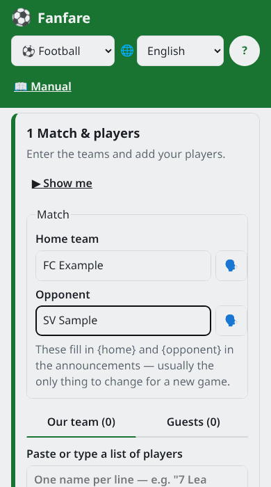
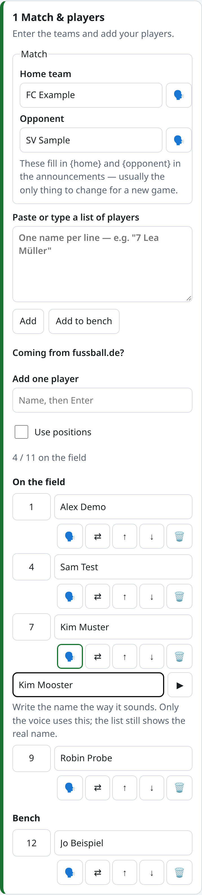
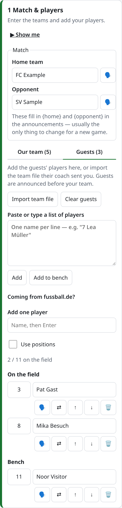
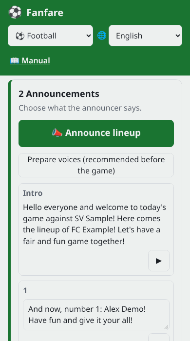
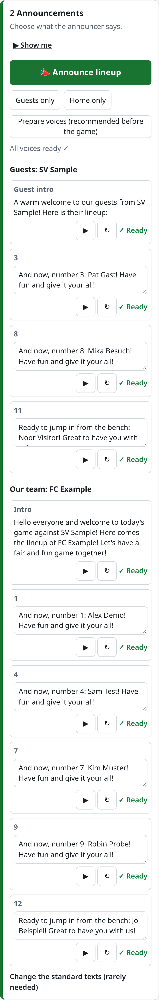
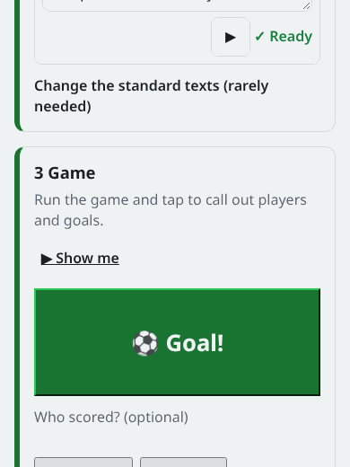
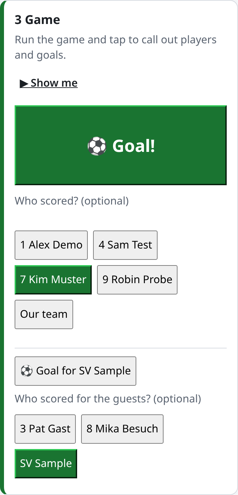
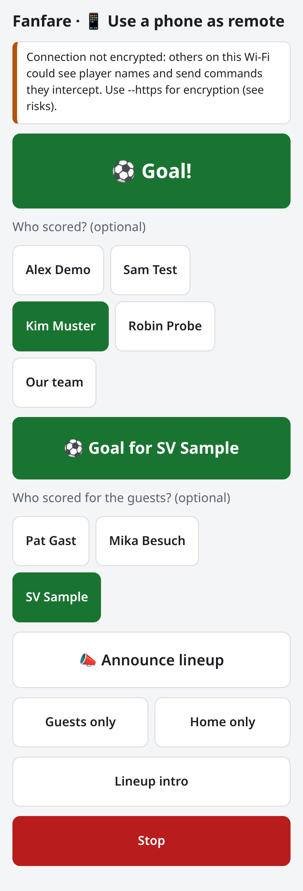
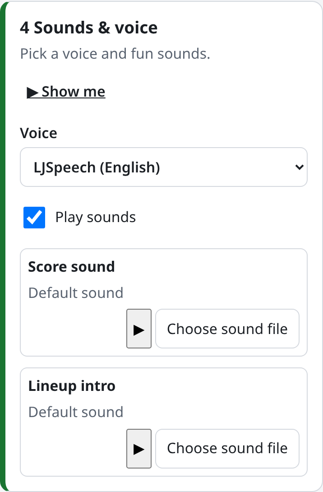
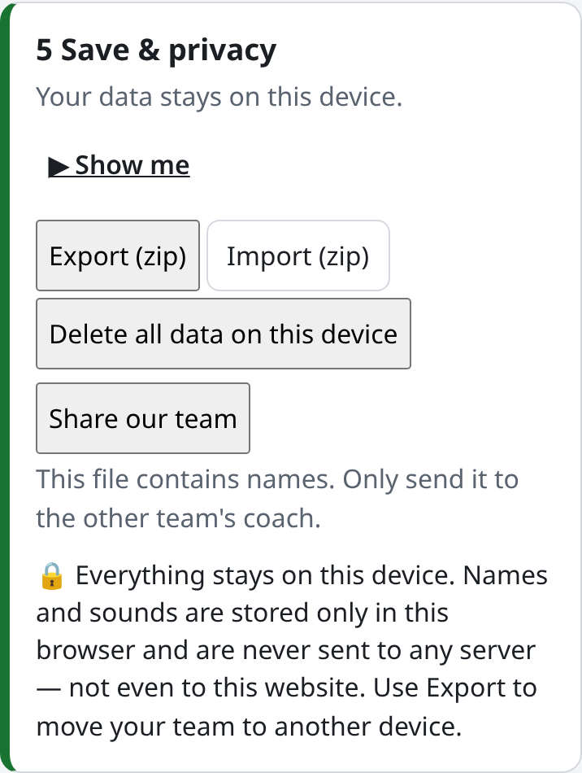

# Fanfare: getting started

Fanfare is a web page that announces your team like a stadium speaker. You type in your players once. A voice then reads out the lineup, and calls the scorer after every goal. It works in your browser, needs no account and costs nothing.

## 1. What is Fanfare?

Fanfare has five steps, one below the other: **1 Match & players**, **2 Announcements**, **3 Game**, **4 Sounds & voice** and **5 Save & privacy**. Open the page on a phone or tablet, work from top to bottom, and put the device next to the loudspeaker. Everything runs on your own device. There is no sign-up and no server that holds your data.

## 2. Before the first game

At the top, pick your **Sport** and your **Language**. The sport decides the word on the score button (Goal, Basket, Point) and the positions you can choose.

In step 1, fill in **Home team** and **Opponent**. Then paste your players into the box **Paste or type a list of players**, one per line, shirt number first, for example `7 Kim Muster`. Press **Add** and the players appear in the list **On the field**. Press **Add to bench** instead for substitutes. You can also type a single name into **Add one player** and press Enter.

Each row has small buttons: **⇄** moves a player between the field and the bench, **↑** and **↓** change the order, **🗑** removes the player (you can undo for a few seconds). Tick **Use positions** if the announcer should also say "Goalkeeper" or "Midfield".

**🗣 Say it like…** fixes how a name is pronounced. Press 🗣 on a row and write the name the way it sounds, for example `Kim Mooster`. Only the voice uses this text. The list still shows the real name. Press ▶ to hear it. The same 🗣 button sits next to the team names. **✨ Suggest** can find a spelling for you: choose the language of the name, enter its original spelling (for example `Nguyễn`), and the app proposes up to three respellings that the voice says close to the real pronunciation. Press ▶ to hear each one and **Use this** to take it. This works offline; at the moment it is available for German and English voices.

**Tip:** if your club uses fussball.de, open **your own team's** squad there, copy it and paste it into the box. Shirt numbers and names are recognised. Fanfare never connects to fussball.de. Open "Coming from fussball.de?" in step 1 for details.

**Playing against another Fanfare club? Swap team files.** In step 5, press **Share our team** and send the file (by e-mail or on a USB stick) to the other team's coach. The file contains names. Only send it to the other team's coach. When you receive their file, open the **Guests** tab in step 1, press **Import team file** and choose it. The guests appear in their own list and the opponent is filled in. **Clear guests** removes them again.

## 3. On game day

1. In step 1, enter the **Opponent**. This is usually the only thing that changes from game to game.

2. Open step 2 **Announcements**. Every player has a text. You can read it, change it, and press ▶ to hear it. The **Intro** row is the welcome text. Rarely needed: "Change the standard texts" at the bottom changes all texts at once.

3. Press **Prepare voices (recommended before the game)** while you still have Wi-Fi. The first time, the voice is downloaded to your device, which takes a short while. A counter such as `3 / 6` shows the progress. Wait for **All voices ready ✓**. After that the announcer also works without internet.

4. When the teams line up, press **📣 Announce lineup**. The intro sound plays, then the announcer reads the lineup. **Stop** ends it at any time.

**Prepare at home.** Open Fanfare with Wi-Fi, press **Prepare voices**, and check that step 5 shows **Offline ready ✓**. After that Fanfare works offline at the pitch. To use it from your home screen (browser menu: "Install app" or "Add to Home Screen"): **on iPhone and iPad add it to the home screen first**, then open it from the icon with Wi-Fi, press **Prepare voices** and check **Offline ready ✓** there. A home-screen app on iOS keeps its own storage, so what you prepared in Safari is not available in it.

**Guests come first.** If you imported a guest team, **📣 Announce lineup** welcomes the guests and reads out their lineup, then reads yours. **Guests only** and **Home only** play just one team. **Prepare voices** covers both teams. In step 3 an extra button **Goal for SV Sample** announces the guests' goals.

## 4. During the game

Open step 3 **Game**. The big button, for example **⚽ Goal!**, plays the score sound and the announcer calls the goal.

To name the scorer, tap the player below the button first, for example **7 Kim Muster**. The name is then part of the call. Tap the player again to unselect, or tap **Our team** for a goal without a name. **Stop** ends the sound early.

**Phone as remote.** If you run Fanfare from your laptop (see "No internet at all?" in section 7) and start it with `--lan`, a phone on the same Wi-Fi can be the soundboard while the laptop plays through the speakers. In step 3 open **📱 Use a phone as remote** and press **Activate speaker** (one tap, so the laptop may play sound). Scan the QR code with the phone, or open the address shown, and enter the 6-digit code. The phone shows big buttons for the goal and the scorer, the lineup, **Stop** and the intro sound. The sound always comes from the laptop. Up to three phones can join; after a phone has paired, the laptop shows a fresh code for the next one. **End remote** disconnects all phones. Over plain http the connection is not encrypted: others on the Wi-Fi could see player names and send commands they intercept. For encryption start with `--https` (see the risks in section 7). It does not work with the online demo.

## 5. Your own sounds and voice

Open step 4 **Sounds & voice**. Here you can:

- choose the **Voice** (one or more per language),
- switch **Play sounds** on or off,
- load your own sound for **Score sound** or **Lineup intro** with **Choose sound file**. Press ▶ to try it, and **Reset to default** brings back the original. Files can be up to 10 MB.

**Voices from your own computer (advanced).** If you run a voice server such as Fanfare Studio on your own computer, open **Local voice server (advanced)** in step 4 and press **Connect**. Its voices then appear in the voice list under **On this computer**. Pick one, press **Prepare voices** and **Export**, and import the zip on your phone: on game day the phone plays the saved clips without the server. If a clip sounds odd, press **↻ Regenerate** on its row. If Fanfare says the server does not allow this website, it shows the exact command (`fanfare-studio allow …`) to run once on that computer, with a **Copy command** button. Only addresses on your own computer (localhost or 127.0.0.1) are accepted. Fanfare Studio marks every clip as AI-generated; check the licence of a voice model before you share clips outside your club.

**Your club's own announcer voice.** With a connected voice server you can press **🎙 Record club voice**, read the short text aloud (about 15 seconds, it stops by itself after 20), listen to it with ▶, give the voice a name and tick the consent box. Use only your own voice or the voice of someone who agreed that it may be used for your club's announcements, and never imitate famous people or anyone who has not agreed. The recording goes only to your own computer and is not kept in Fanfare, not even in the export. The new voice appears under **On this computer**. The **🗑** button deletes it, including its recording on the voice server.

## 6. Save, move to another device, delete

Open step 5 **Save & privacy**.

- **Export (zip)** saves your team, settings, sounds and the prepared voice clips as a file named like `fanfare-2026-11-13.zip`.
- **Import (zip)** loads such a file on another device, or after a reset. It replaces what is on the device.
- **Delete all data on this device** removes everything for good.
- Please export once in a while, as a backup.

**Privacy in plain words:** your team, names and sounds stay in this browser on this device. They are never sent to any server, not even to the website that hosts Fanfare. There is no tracking and no account. The page only ever talks to its own address.

## 7. Troubleshooting

- **No sound on an iPhone or iPad:** check that the silent switch on the side is off and the volume is up. Tap once on the page or on the button, then press again. The first sound after opening the page needs a tap.
- **The voice download is slow:** the voice is downloaded only once. Press **Prepare voices** at home on good Wi-Fi, not at the pitch.
- **Your team is gone after reopening:** a private or incognito window cannot save anything. Use a normal window, or use **Export (zip)** before you close it.
- **The speaker:** connect a Bluetooth speaker or a cable to the device, and test with ▶ before the game. Turn off any "do not disturb" mode.
- **Which browsers:** current Chrome, Edge or Firefox, and Safari or iOS 16.4 or newer.
- **Offline does not work (no "Offline ready ✓" in step 5):** open Fanfare once with Wi-Fi, wait a moment, then reload the page. Then press **Prepare voices** and wait for **All voices ready ✓**. If a message says an update is available, press **Reload** between announcements.
- **No internet at all? Run Fanfare from your laptop:** download the package for your language from `github.com/Lyzair/fanfare/releases` (for example `fanfare-1.0.0-en.zip`), unpack it and double-click `start-fanfare.bat` (Windows) or `start-fanfare.command` (Mac), or run `start-fanfare.sh` (Linux). Python 3.9 or newer must be installed. Your browser opens Fanfare, and after **Prepare voices** it needs no network. For phones on the same Wi-Fi, start it with `--lan` (for example `./start-fanfare.sh --lan`) and open the address shown in the window. That works, but over plain http a phone cannot use offline mode or the microphone. **Optional, with risks:** `--lan --https` creates a local certificate authority on the laptop after you type `yes`. Then open `<address>/trust.html` once on each phone and follow the steps (install the certificate; on an iPhone also switch on full trust), and compare the fingerprint with the one in the laptop window. Please know: a phone that trusts this certificate trusts everything signed with this laptop's key (limited to local network addresses, but that includes routers, NAS drives and smart-home devices); the key is stored unencrypted on the laptop, so only do this on a computer you trust. Remove it when you no longer need it: start with `--forget-ca` on the laptop and remove the certificate in each phone's settings (Android: Security, Encryption & credentials, User credentials; iPhone: General, VPN & Device Management). Simpler alternatives that need no certificate: the online demo on the phone, or Fanfare directly on the laptop with its speakers.
- **Run it with Docker:** IT-savvy club members can also run Fanfare with Docker; see `docs/self-hosting.md`. IT helpers can also set up a Raspberry Pi in the club house that serves Fanfare to every phone on the club Wi-Fi: see `deploy/raspberry-pi/README.md`; behind an existing reverse proxy, `docs/self-hosting.md` describes Caddy, Traefik and Nginx Proxy Manager.
