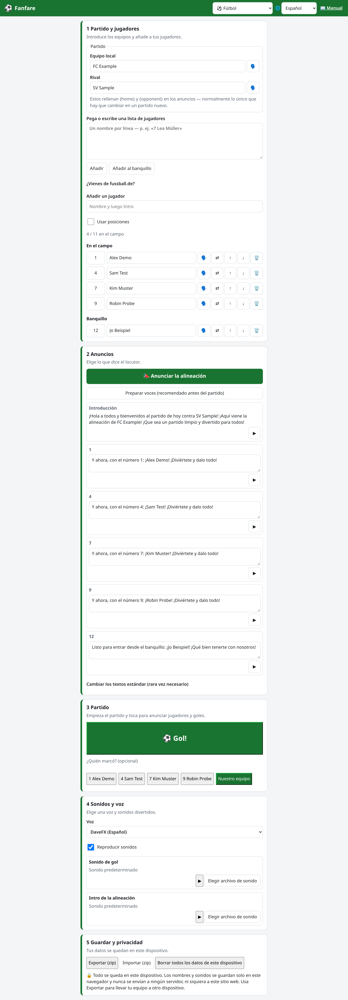
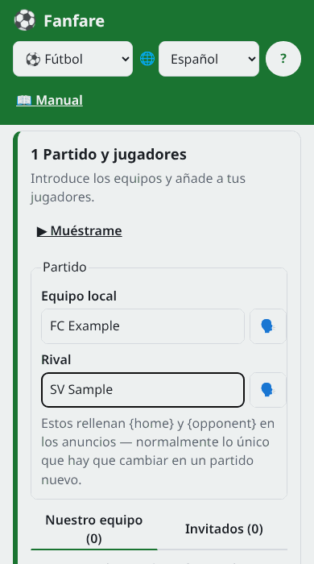
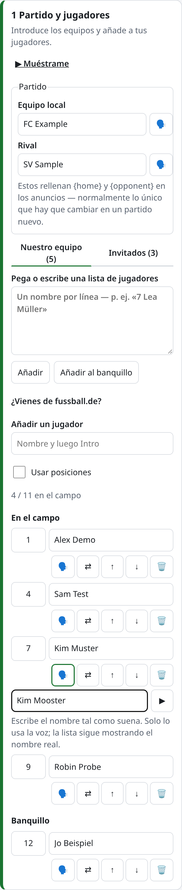
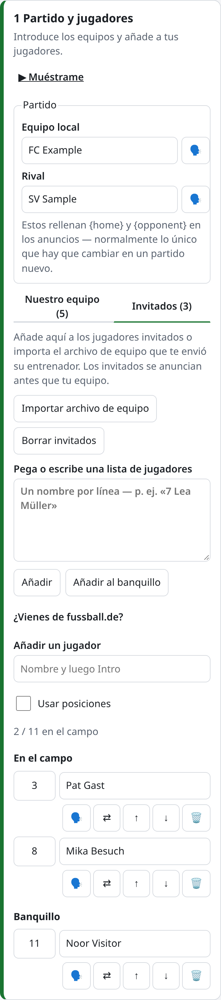
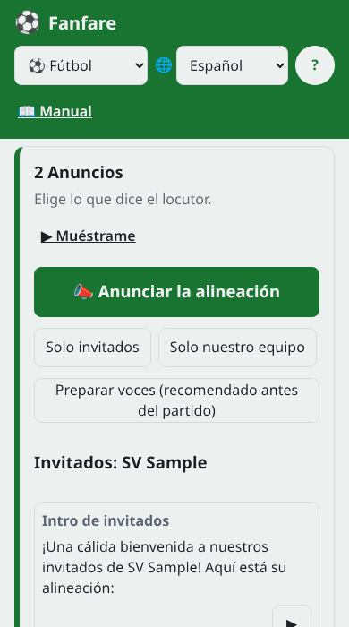
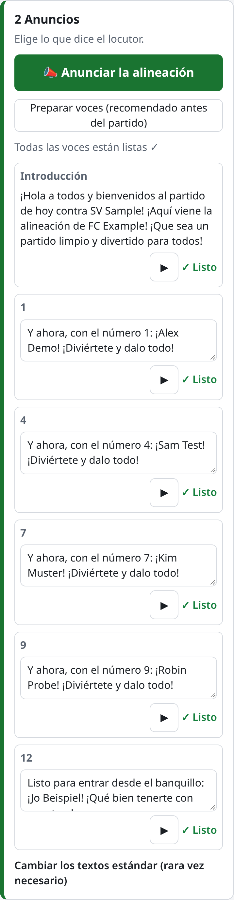
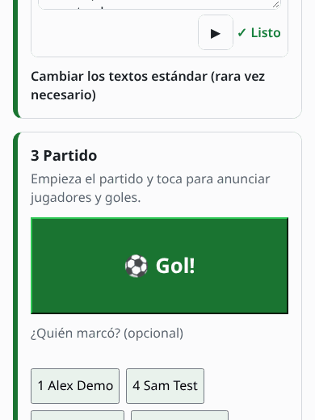
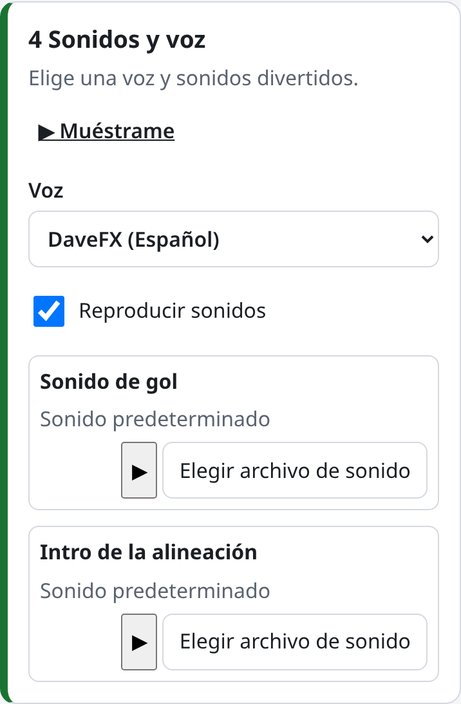
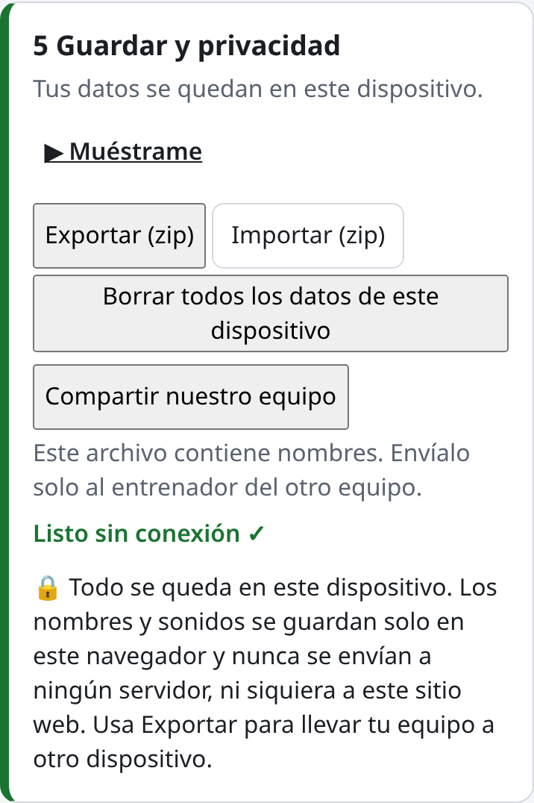

<!-- Translation: machine-assisted — native speakers, please review. -->

# Fanfare: primeros pasos

Fanfare es una página web que presenta a tu equipo como un locutor de estadio. Escribes tus jugadores una sola vez. Después una voz lee la alineación y anuncia al goleador tras cada gol. Funciona en el navegador, sin cuenta y sin coste.

## 1. ¿Qué es Fanfare?

Fanfare tiene cinco pasos, uno debajo de otro: **1 Partido y jugadores**, **2 Anuncios**, **3 Partido**, **4 Sonidos y voz** y **5 Guardar y privacidad**. Abre la página en un móvil o tableta, trabaja de arriba abajo y coloca el dispositivo junto al altavoz. Todo funciona en tu propio dispositivo. No hay registro ni servidor que reciba tus datos.

## 2. Antes del primer partido

Arriba, elige tu **Deporte** y tu **Idioma**. El deporte decide la palabra del botón de marcador (Gol, Canasta, Punto) y las posiciones disponibles.

En el paso 1, rellena **Equipo local** y **Rival**. Después pega tus jugadores en el cuadro **Pega o escribe una lista de jugadores**, uno por línea, con el dorsal primero, por ejemplo `7 Kim Muster`. Con **Añadir**, los jugadores aparecen en la lista **En el campo**. Con **Añadir al banquillo**, los suplentes van al banquillo. Para un solo nombre usa **Añadir un jugador** y pulsa Intro.

Cada fila tiene botones pequeños: **⇄** mueve a un jugador entre el campo y el banquillo, **↑** y **↓** cambian el orden, **🗑** quita al jugador (puedes deshacerlo unos segundos). Marca **Usar posiciones** si el locutor también debe decir "Portero" o "Centrocampista".

**🗣 Dilo como…** fija cómo se pronuncia un nombre. Pulsa 🗣 en una fila y escribe el nombre tal como suena, por ejemplo `Kim Mooster`. Solo la voz usa este texto. La lista sigue mostrando el nombre real. Pulsa ▶ para oírlo. El mismo botón 🗣 está junto a los nombres de los equipos. **✨ Sugerir** puede encontrar una ortografía por ti: elige el idioma del nombre, escribe su ortografía original (por ejemplo `Nguyễn`) y la aplicación propone hasta tres grafías que la voz pronuncia cerca de la pronunciación real. Pulsa ▶ para oír cada una y **Usar** para quedarte con ella. Funciona sin conexión; por ahora está disponible para las voces alemana e inglesa.

**Consejo:** si tu club usa fussball.de, abre allí la plantilla de **tu propio equipo**, cópiala y pégala en el cuadro. Se reconocen dorsales y nombres. Fanfare nunca se conecta a fussball.de. Más información en "¿Vienes de fussball.de?" en el paso 1.

**¿Juegas contra otro club con Fanfare? Intercambiad archivos de equipo.** En el paso 5, pulsa **Compartir nuestro equipo** y envía el archivo (por correo electrónico o en una memoria USB) al entrenador del otro equipo. El archivo contiene nombres. Envíalo solo al entrenador del otro equipo. Cuando recibas el suyo, abre la pestaña **Invitados** en el paso 1, pulsa **Importar archivo de equipo** y elígelo. Los invitados aparecen en su propia lista y se rellena el rival. **Borrar invitados** los quita de nuevo.

## 3. El día del partido

1. En el paso 1, escribe el **Rival**. Normalmente es lo único que cambia de un partido a otro.

2. Abre el paso 2 **Anuncios**. Cada jugador tiene un texto que puedes leer, cambiar y escuchar con ▶. La fila **Introducción** es el texto de bienvenida. Rara vez necesario: "Cambiar los textos estándar", abajo, cambia todos los textos a la vez.

3. Pulsa **Preparar voces (recomendado antes del partido)** mientras aún tengas Wi-Fi. La primera vez, la voz se descarga a tu dispositivo, lo que tarda un poco. Un contador como `3 / 6` muestra el progreso. Espera a **Todas las voces están listas ✓**. Después el locutor también funciona sin internet.

4. Cuando salgan los equipos, pulsa **📣 Anunciar la alineación**. Suena el sonido de intro y luego la voz lee la alineación. **Detener** la termina en cualquier momento.

**Prepararlo en casa.** Abre Fanfare una vez con Wi-Fi y pulsa **Preparar voces**. Después Fanfare funciona sin internet en el campo. En el paso 5 verás **Listo sin conexión ✓**. También puedes añadirlo a la pantalla de inicio (menú del navegador: «Instalar aplicación» o «Añadir a la pantalla de inicio»).

**Los invitados van primero.** Si importaste un equipo invitado, **📣 Anunciar la alineación** da la bienvenida a los invitados y lee su alineación, y después la tuya. **Solo invitados** y **Solo nuestro equipo** anuncian solo un equipo. **Preparar voces** abarca los dos equipos. En el paso 3 hay un botón adicional **Gol para SV Sample** para los goles de los invitados.

## 4. Durante el partido

Abre el paso 3 **Partido**. El botón grande, por ejemplo **⚽ Gol!**, reproduce el sonido de gol y la voz canta el gol.

Para nombrar al goleador, toca primero al jugador bajo el botón, por ejemplo **7 Kim Muster**. Su nombre forma parte del anuncio. Tócalo de nuevo para quitarlo, o toca **Nuestro equipo** para un gol sin nombre. **Detener** corta el sonido antes.

## 5. Tus propios sonidos y tu voz

Abre el paso 4 **Sonidos y voz**. Aquí puedes:

- elegir la **Voz** (una o varias por idioma),
- activar o desactivar **Reproducir sonidos**,
- cargar tu propio sonido para **Sonido de gol** o **Intro de la alineación** con **Elegir archivo de sonido**. Con ▶ lo pruebas y **Restablecer valor predeterminado** devuelve el original. Los archivos pueden pesar hasta 10 MB.

## 6. Guardar, pasar a otro dispositivo, borrar

Abre el paso 5 **Guardar y privacidad**.

- **Exportar (zip)** guarda tu equipo, ajustes y sonidos en un archivo con un nombre como `fanfare-2026-11-13.zip`.
- **Importar (zip)** carga ese archivo en otro dispositivo o tras un reinicio. Sustituye lo que hay en el dispositivo.
- **Borrar todos los datos de este dispositivo** lo elimina todo para siempre.
- Exporta de vez en cuando, como copia de seguridad.

**Privacidad en palabras sencillas:** tu equipo, los nombres y los sonidos se quedan en este navegador, en este dispositivo. No se envían a ningún servidor, ni siquiera al sitio web que aloja Fanfare. No hay seguimiento ni cuenta. La página solo habla con su propia dirección.

## 7. Solución de problemas

- **Sin sonido en iPhone o iPad:** comprueba que el interruptor de silencio esté desactivado y el volumen alto. Toca una vez la página o el botón y vuelve a pulsar. El primer sonido tras abrir la página necesita un toque.
- **La descarga de la voz es lenta:** la voz se descarga solo una vez. Pulsa **Preparar voces** en casa con buen Wi-Fi, no en el campo.
- **El equipo ha desaparecido al reabrir:** una ventana privada no puede guardar nada. Usa una ventana normal o **Exportar (zip)** antes de cerrarla.
- **El altavoz:** conecta un altavoz Bluetooth o un cable al dispositivo y prueba con ▶ antes del partido. Desactiva "No molestar".
- **Navegadores:** Chrome, Edge o Firefox actuales, y Safari o iOS 16.4 o posterior.
- **No funciona sin conexión (no aparece «Listo sin conexión ✓» en el paso 5):** abre Fanfare una vez con Wi-Fi, espera un momento y recarga la página. Luego pulsa **Preparar voces** y espera a **Todas las voces están listas ✓**. Si aparece un aviso de actualización, pulsa **Recargar** entre dos anuncios.
