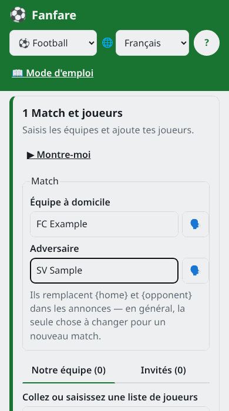
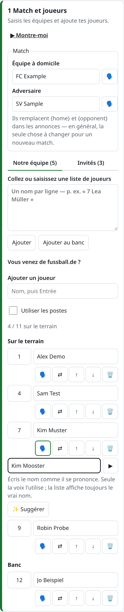
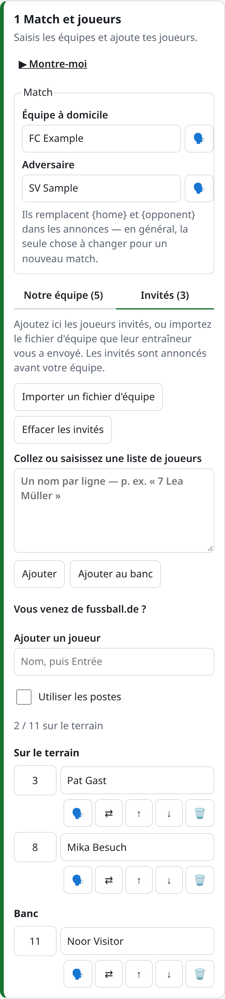
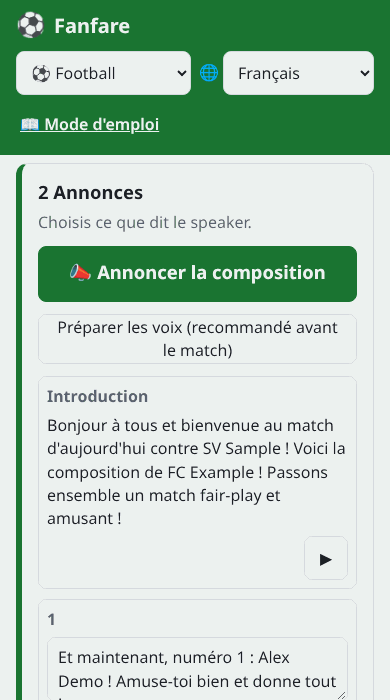
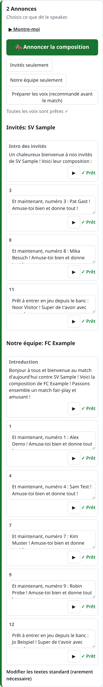
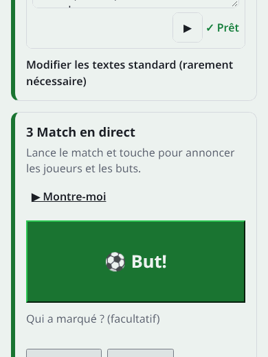
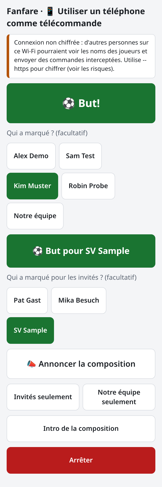
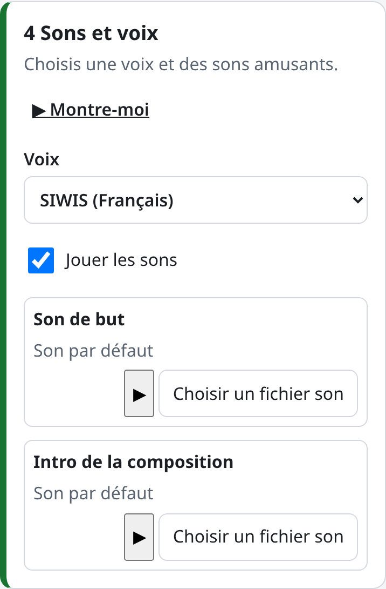
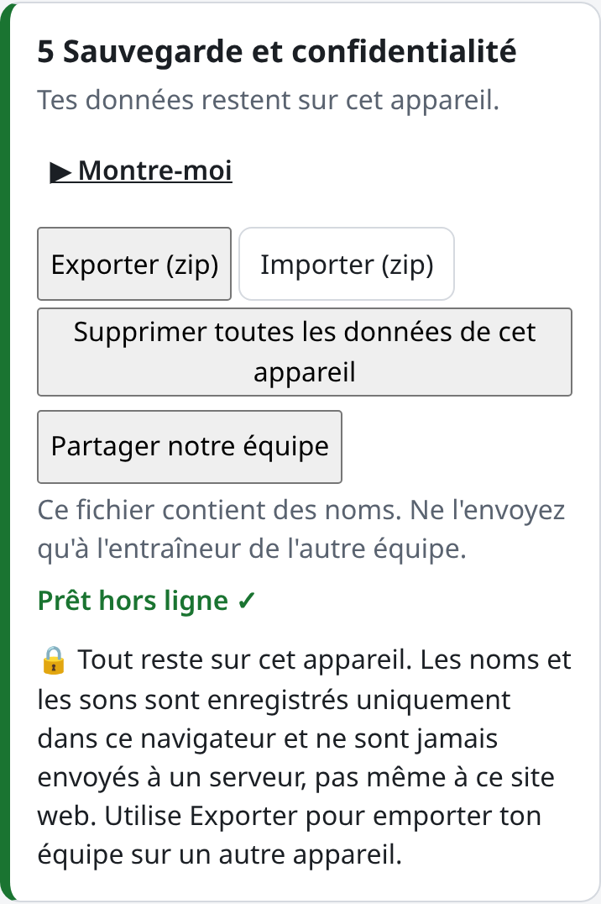

<!-- Translation: machine-assisted — native speakers, please review. -->

# Fanfare : prise en main

Fanfare est une page web qui présente votre équipe comme un speaker de stade. Vous saisissez vos joueurs une seule fois. Une voix lit ensuite la composition et annonce le buteur après chaque but. Tout fonctionne dans le navigateur, sans compte et gratuitement.

## 1. Qu'est-ce que Fanfare ?

Fanfare compte cinq étapes l'une sous l'autre : **1 Match et joueurs**, **2 Annonces**, **3 Match en direct**, **4 Sons et voix** et **5 Sauvegarde et confidentialité**. Ouvrez la page sur un téléphone ou une tablette, travaillez de haut en bas et placez l'appareil près du haut-parleur. Tout reste sur votre appareil. Il n'y a ni inscription ni serveur qui reçoit vos données.

## 2. Avant le premier match

En haut, choisissez votre **Sport** et votre **Langue**. Le sport détermine le mot du bouton de score (But, Panier, Point) et les postes proposés.

À l'étape 1, remplissez **Équipe à domicile** et **Adversaire**. Collez ensuite vos joueurs dans la zone **Collez ou saisissez une liste de joueurs**, un par ligne, le numéro de maillot d'abord, par exemple `7 Kim Muster`. Avec **Ajouter**, les joueurs apparaissent dans la liste **Sur le terrain**. Avec **Ajouter au banc**, les remplaçants vont sur le banc. Pour un seul nom, utilisez **Ajouter un joueur** puis Entrée.

Chaque ligne a de petits boutons : **⇄** déplace un joueur entre le terrain et le banc, **↑** et **↓** changent l'ordre, **🗑** supprime le joueur (vous pouvez annuler pendant quelques secondes). Cochez **Utiliser les postes** si la voix doit aussi dire "Gardien" ou "Milieu".

**🗣 Dis-le comme…** règle la prononciation d'un nom. Appuyez sur 🗣 sur une ligne et écrivez le nom comme il se prononce, par exemple `Kim Mooster`. Seule la voix utilise ce texte. La liste affiche toujours le vrai nom. Appuyez sur ▶ pour l'écouter. Le même bouton 🗣 se trouve à côté des noms d'équipe. **✨ Suggérer** peut trouver une orthographe pour vous : choisissez la langue du nom, saisissez son orthographe d'origine (par exemple `Nguyễn`), et l'application propose jusqu'à trois graphies que la voix prononce proche de la vraie prononciation. Appuyez sur ▶ pour écouter chacune et sur **Utiliser** pour la retenir. Cela fonctionne hors ligne ; pour l'instant, c'est disponible pour les voix allemande et anglaise.

**Astuce :** si votre club utilise fussball.de, ouvrez l'effectif de **votre propre équipe** sur ce site, copiez-le et collez-le dans la zone. Les numéros et les noms sont reconnus. Fanfare ne se connecte jamais à fussball.de. Voir "Vous venez de fussball.de ?" à l'étape 1.

**Vous jouez contre un autre club Fanfare ? Échangez vos fichiers d'équipe.** À l'étape 5, appuyez sur **Partager notre équipe** et envoyez le fichier (par e-mail ou clé USB) à l'entraîneur de l'autre équipe. Le fichier contient des noms. Ne l'envoyez qu'à l'entraîneur de l'autre équipe. Quand vous recevez leur fichier, ouvrez l'onglet **Invités** à l'étape 1, appuyez sur **Importer un fichier d'équipe** et choisissez-le. Les invités apparaissent dans leur propre liste et l'adversaire est rempli. **Effacer les invités** les supprime à nouveau.

## 3. Le jour du match

1. À l'étape 1, saisissez l'**Adversaire**. C'est généralement la seule chose qui change d'un match à l'autre.

2. Ouvrez l'étape 2 **Annonces**. Chaque joueur a un texte que vous pouvez lire, modifier et écouter avec ▶. La ligne **Introduction** est le texte de bienvenue. Rarement utile : "Modifier les textes standard" en bas change tous les textes d'un coup.

3. Appuyez sur **Préparer les voix (recommandé avant le match)** tant que vous avez du Wi-Fi. La première fois, la voix est téléchargée sur votre appareil, ce qui prend un moment. Un compteur comme `3 / 6` montre la progression. Attendez **Toutes les voix sont prêtes ✓**. Ensuite, le speaker fonctionne aussi sans internet.

4. Quand les équipes entrent, appuyez sur **📣 Annoncer la composition**. Le son d'introduction joue, puis la voix lit la composition. **Arrêter** y met fin à tout moment.

**Préparer à la maison.** Ouvre Fanfare avec le Wi-Fi, appuie sur **Préparer les voix** et vérifie que l'étape 5 affiche **Prêt hors ligne ✓**. Ensuite Fanfare fonctionne sans internet sur le terrain. Pour l'utiliser depuis l'écran d'accueil (menu du navigateur : « Installer l'application » ou « Ajouter à l'écran d'accueil ») : **sur iPhone et iPad, ajoute d'abord l'application à l'écran d'accueil**, puis ouvre-la depuis l'icône avec le Wi-Fi, appuie sur **Préparer les voix** et vérifie **Prêt hors ligne ✓** à cet endroit. Sur iOS, une app de l'écran d'accueil a son propre stockage : ce que tu as préparé dans Safari n'y est pas disponible.

**Les invités passent en premier.** Si vous avez importé une équipe invitée, **📣 Annoncer la composition** accueille d'abord les invités et lit leur composition, puis la vôtre. **Invités seulement** et **Notre équipe seulement** n'annoncent qu'une seule équipe. **Préparer les voix** couvre les deux équipes. À l'étape 3, un bouton supplémentaire **But pour SV Sample** annonce les buts des invités.

## 4. Pendant le match

Ouvrez l'étape 3 **Match en direct**. Le grand bouton, par exemple **⚽ But !**, joue le son de but et la voix annonce le but.

Pour citer le buteur, touchez d'abord le joueur sous le bouton, par exemple **7 Kim Muster**. Son nom fait alors partie de l'annonce. Touchez-le à nouveau pour annuler, ou touchez **Notre équipe** pour un but sans nom. **Arrêter** coupe le son plus tôt.

**Téléphone comme télécommande.** Si tu lances Fanfare depuis ton ordinateur portable (voir « Pas d'internet du tout ? » dans la section 7) avec `--lan`, un téléphone connecté au même Wi-Fi peut servir de pupitre de sons pendant que l'ordinateur joue sur les haut-parleurs. À l'étape 3, ouvre **📱 Utiliser un téléphone comme télécommande** et appuie sur **Activer le haut-parleur** (un seul appui, pour que l'ordinateur puisse jouer du son). Scanne le QR code avec le téléphone, ou ouvre l'adresse affichée, puis saisis le code à 6 chiffres. Le téléphone affiche de grands boutons pour le but et le buteur, la composition, **Arrêter** et le son d'intro. Le son vient toujours de l'ordinateur. Jusqu'à trois téléphones peuvent se connecter ; après l'appairage d'un téléphone, l'ordinateur affiche un nouveau code pour le suivant. **Arrêter la télécommande** déconnecte tous les téléphones. En http simple, la connexion n'est pas chiffrée : d'autres personnes sur le Wi-Fi pourraient voir les noms des joueurs et envoyer des commandes interceptées. Pour chiffrer, démarre avec `--https` (voir les risques dans la section 7). Cela ne fonctionne pas avec la démo en ligne.

## 5. Vos propres sons et votre voix

Ouvrez l'étape 4 **Sons et voix**. Vous pouvez :

- choisir la **Voix** (une ou plusieurs par langue),
- activer ou désactiver **Jouer les sons**,
- charger votre propre son pour **Son de but** ou **Intro de la composition** avec **Choisir un fichier son**. ▶ permet de l'essayer et **Rétablir par défaut** ramène le son d'origine. Les fichiers peuvent atteindre 10 Mo.

## 6. Sauvegarder, changer d'appareil, supprimer

Ouvrez l'étape 5 **Sauvegarde et confidentialité**.

- **Exporter (zip)** enregistre votre équipe, vos réglages et vos sons dans un fichier nommé par exemple `fanfare-2026-11-13.zip`.
- **Importer (zip)** charge un tel fichier sur un autre appareil ou après une réinitialisation. Il remplace ce qui se trouve sur l'appareil.
- **Supprimer toutes les données de cet appareil** efface tout définitivement.
- Exportez de temps en temps, comme sauvegarde.

**La confidentialité en clair :** votre équipe, les noms et les sons restent dans ce navigateur, sur cet appareil. Ils ne sont envoyés à aucun serveur, pas même au site qui héberge Fanfare. Il n'y a ni suivi ni compte. La page ne communique qu'avec sa propre adresse.

## 7. Dépannage

- **Pas de son sur iPhone ou iPad :** vérifiez que le commutateur silencieux est désactivé et le volume monté. Touchez une fois la page ou le bouton, puis appuyez à nouveau. Le premier son après l'ouverture de la page demande un toucher.
- **Le téléchargement de la voix est lent :** la voix n'est téléchargée qu'une fois. Appuyez sur **Préparer les voix** chez vous, avec un bon Wi-Fi, pas au stade.
- **L'équipe a disparu à la réouverture :** une fenêtre privée ne peut rien enregistrer. Utilisez une fenêtre normale ou **Exporter (zip)** avant de la fermer.
- **Le haut-parleur :** connectez une enceinte Bluetooth ou un câble à l'appareil et testez avec ▶ avant le match. Désactivez le mode "Ne pas déranger".
- **Navigateurs :** Chrome, Edge ou Firefox récents, et Safari ou iOS 16.4 ou plus récent.
- **Le mode hors ligne ne marche pas (pas de « Prêt hors ligne ✓ » à l'étape 5) :** ouvre Fanfare une fois avec le Wi-Fi, attends un instant, puis recharge la page. Appuie ensuite sur **Préparer les voix** et attends **Toutes les voix sont prêtes ✓**. Si une mise à jour est proposée, appuie sur **Recharger** entre deux annonces.
- **Pas d'internet du tout ? Lancez Fanfare depuis votre ordinateur portable :** décompressez le paquet `fanfare-local` et double-cliquez sur `start-fanfare.bat` (Windows) ou `start-fanfare.command` (Mac), ou lancez `start-fanfare.sh` (Linux). Python 3.9 ou plus récent doit être installé. Votre navigateur ouvre Fanfare, et après **Préparer les voix** plus aucun réseau n'est nécessaire. Pour des téléphones sur le même Wi-Fi, démarrez avec `--lan` (par exemple `./start-fanfare.sh --lan`) et ouvrez l'adresse affichée dans la fenêtre. Cela fonctionne, mais en http simple un téléphone ne peut ni travailler hors ligne ni utiliser le microphone. **Facultatif, avec des risques :** `--lan --https` crée une autorité de certification locale sur l'ordinateur après que vous avez tapé `yes`. Ouvrez ensuite une fois `<adresse>/trust.html` sur chaque téléphone et suivez les étapes (installer le certificat ; sur iPhone, activer aussi la confiance totale), puis comparez l'empreinte avec celle de la fenêtre de l'ordinateur. Sachez-le : un téléphone qui fait confiance à ce certificat fait confiance à tout ce qui est signé avec la clé de cet ordinateur (limité aux adresses du réseau local, mais cela inclut routeurs, NAS et appareils domotiques) ; la clé est stockée sans chiffrement sur l'ordinateur, ne le faites donc que sur un ordinateur de confiance. Supprimez-le quand vous n'en avez plus besoin : démarrez avec `--forget-ca` sur l'ordinateur et retirez le certificat dans les réglages de chaque téléphone (Android : Sécurité, Chiffrement et identifiants, Identifiants utilisateur ; iPhone : Général, VPN et gestion de l'appareil). Alternatives plus simples, sans certificat : la démo en ligne sur le téléphone, ou Fanfare directement sur l'ordinateur avec ses haut-parleurs.
