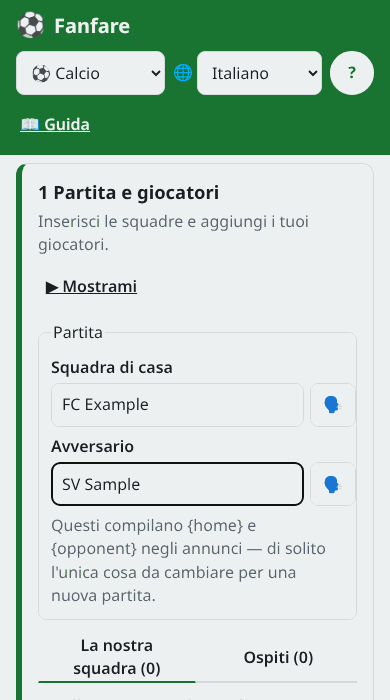
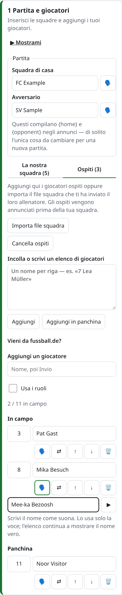
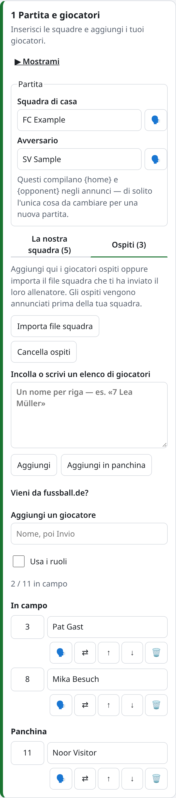
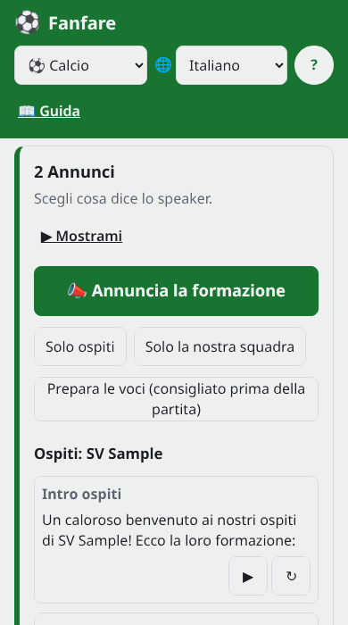
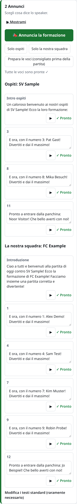
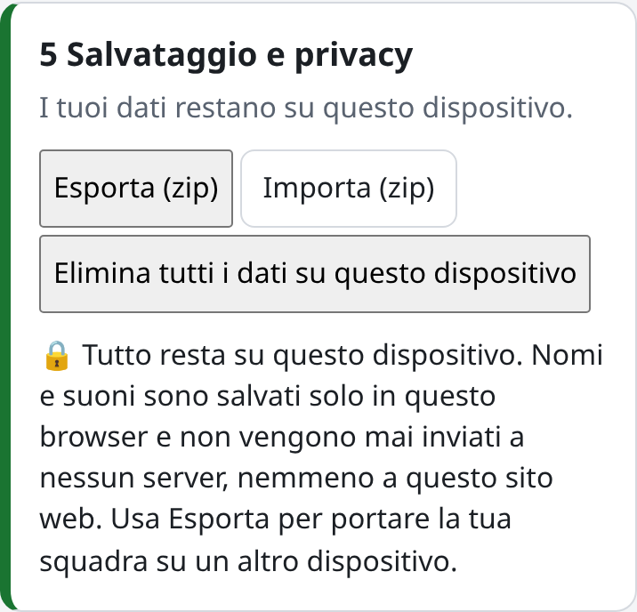

<!-- Translation: machine-assisted — native speakers, please review. -->

# Fanfare: guida rapida

Fanfare è una pagina web che presenta la tua squadra come lo speaker di uno stadio. Inserisci i giocatori una volta sola. Poi una voce legge la formazione e annuncia il marcatore dopo ogni gol. Funziona nel browser, senza account e gratis.

## 1. Che cos'è Fanfare?

Fanfare ha cinque passaggi uno sotto l'altro: **1 Partita e giocatori**, **2 Annunci**, **3 Partita**, **4 Suoni e voce** e **5 Salvataggio e privacy**. Apri la pagina su telefono o tablet, procedi dall'alto in basso e metti il dispositivo vicino all'altoparlante. Tutto funziona sul tuo dispositivo. Non c'è registrazione né un server che riceva i tuoi dati.

## 2. Prima della prima partita

In alto scegli lo **Sport** e la **Lingua**. Lo sport decide la parola sul pulsante del punteggio (Gol, Canestro, Punto) e i ruoli selezionabili.

Nel passaggio 1 compila **Squadra di casa** e **Avversario**. Poi incolla i giocatori nel campo **Incolla o scrivi un elenco di giocatori**, uno per riga, prima il numero di maglia, per esempio `7 Kim Muster`. Con **Aggiungi** i giocatori compaiono nell'elenco **In campo**. Con **Aggiungi in panchina** le riserve vanno in panchina. Per un solo nome usa **Aggiungi un giocatore** e premi Invio.

Ogni riga ha piccoli pulsanti: **⇄** sposta un giocatore tra campo e panchina, **↑** e **↓** cambiano l'ordine, **🗑** rimuove il giocatore (puoi annullare per qualche secondo). Spunta **Usa i ruoli** se lo speaker deve dire anche "Portiere" o "Centrocampo".

**🗣 Dillo come…** stabilisce come si pronuncia un nome. Premi 🗣 su una riga e scrivi il nome come suona, per esempio `Kim Mooster`. Solo la voce usa questo testo. L'elenco continua a mostrare il nome vero. Premi ▶ per ascoltarlo. Lo stesso pulsante 🗣 è accanto ai nomi delle squadre. **✨ Suggerisci** può trovare una grafia per te: scegli la lingua del nome, inserisci la sua ortografia originale (per esempio `Nguyễn`) e l'app propone fino a tre grafie che la voce pronuncia vicino alla pronuncia reale. Premi ▶ per ascoltarle e **Usa** per sceglierne una. Funziona offline; per ora è disponibile per le voci tedesca e inglese.

**Consiglio:** se la tua società usa fussball.de, apri lì la rosa della **tua squadra**, copiala e incollala nel campo. Numeri e nomi vengono riconosciuti. Fanfare non si collega mai a fussball.de. Maggiori dettagli in "Vieni da fussball.de?" nel passaggio 1.

**Giochi contro un altro club che usa Fanfare? Scambiatevi i file squadra.** Al passaggio 5 premi **Condividi la nostra squadra** e invia il file (via e-mail o con una chiavetta USB) all'allenatore dell'altra squadra. Il file contiene nomi. Invialo solo all'allenatore dell'altra squadra. Quando ricevi il loro file, apri la scheda **Ospiti** al passaggio 1, premi **Importa file squadra** e sceglilo. Gli ospiti compaiono in un elenco a parte e l'avversario viene compilato. **Cancella ospiti** li rimuove di nuovo.

## 3. Il giorno della partita

1. Nel passaggio 1 inserisci l'**Avversario**. Di solito è l'unica cosa che cambia da una partita all'altra.

2. Apri il passaggio 2 **Annunci**. Ogni giocatore ha un testo che puoi leggere, modificare e ascoltare con ▶. La riga **Introduzione** è il testo di benvenuto. Raramente necessario: "Modifica i testi standard" in fondo cambia tutti i testi insieme.

3. Premi **Prepara le voci (consigliato prima della partita)** finché hai il Wi-Fi. La prima volta la voce viene scaricata sul dispositivo e ci vuole un po'. Un contatore come `3 / 6` mostra l'avanzamento. Aspetta **Tutte le voci sono pronte ✓**. Poi lo speaker funziona anche senza internet.

4. Quando le squadre entrano in campo, premi **📣 Annuncia la formazione**. Parte il suono d'introduzione, poi la voce legge la formazione. **Stop** la interrompe in qualsiasi momento.

**Preparare a casa.** Apri Fanfare con il Wi-Fi, premi **Prepara le voci** e controlla che nel passo 5 compaia **Pronto offline ✓**. Dopo di che Fanfare funziona senza internet al campo. Per usarlo dalla schermata Home (menu del browser: «Installa app» o «Aggiungi a schermata Home»): **su iPhone e iPad aggiungilo prima alla schermata Home**, poi aprilo dall'icona con il Wi-Fi, premi **Prepara le voci** e controlla lì **Pronto offline ✓**. Su iOS un'app della schermata Home ha una memoria propria, quindi ciò che hai preparato in Safari non è disponibile al suo interno.

**Gli ospiti vengono per primi.** Se hai importato una squadra ospite, **📣 Annuncia la formazione** dà il benvenuto agli ospiti e legge la loro formazione, poi la tua. **Solo ospiti** e **Solo la nostra squadra** annunciano una sola squadra. **Prepara le voci** copre entrambe le squadre. Al passaggio 3 un pulsante in più, **Gol per SV Sample**, annuncia i gol degli ospiti.

## 4. Durante la partita

Apri il passaggio 3 **Partita**. Il pulsante grande, per esempio **⚽ Gol!**, riproduce il suono del gol e la voce annuncia il gol.

Per nominare il marcatore, tocca prima il giocatore sotto il pulsante, per esempio **7 Kim Muster**. Il nome entra nell'annuncio. Toccalo di nuovo per deselezionarlo, oppure tocca **La nostra squadra** per un gol senza nome. **Stop** interrompe il suono prima.

## 5. I tuoi suoni e la tua voce

Apri il passaggio 4 **Suoni e voce**. Qui puoi:

- scegliere la **Voce** (una o più per lingua),
- attivare o disattivare **Riproduci i suoni**,
- caricare un tuo suono per **Suono del gol** o **Intro della formazione** con **Scegli file audio**. Con ▶ lo provi e **Ripristina predefinito** riporta l'originale. I file possono essere fino a 10 MB.

## 6. Salvare, passare a un altro dispositivo, eliminare

Apri il passaggio 5 **Salvataggio e privacy**.

- **Esporta (zip)** salva squadra, impostazioni e suoni in un file con un nome come `fanfare-2026-11-13.zip`.
- **Importa (zip)** carica un file simile su un altro dispositivo o dopo un ripristino. Sostituisce ciò che c'è sul dispositivo.
- **Elimina tutti i dati su questo dispositivo** cancella tutto definitivamente.
- Esporta ogni tanto, come copia di sicurezza.

**La privacy in parole semplici:** la tua squadra, i nomi e i suoni restano in questo browser, su questo dispositivo. Non vengono inviati a nessun server, nemmeno al sito che ospita Fanfare. Non c'è tracciamento né account. La pagina parla solo con il proprio indirizzo.

## 7. Risoluzione dei problemi

- **Nessun suono su iPhone o iPad:** controlla che l'interruttore del silenzioso sia disattivato e il volume alto. Tocca una volta la pagina o il pulsante e poi premi di nuovo. Il primo suono dopo l'apertura della pagina richiede un tocco.
- **Il download della voce è lento:** la voce si scarica una sola volta. Premi **Prepara le voci** a casa con un buon Wi-Fi, non al campo.
- **La squadra è sparita alla riapertura:** una finestra privata non può salvare nulla. Usa una finestra normale oppure **Esporta (zip)** prima di chiuderla.
- **L'altoparlante:** collega un altoparlante Bluetooth o un cavo al dispositivo e prova con ▶ prima della partita. Disattiva "Non disturbare".
- **Browser:** Chrome, Edge o Firefox recenti, e Safari o iOS 16.4 o successivo.
- **Offline non funziona (nel passo 5 non c'è «Pronto offline ✓»):** apri Fanfare una volta con il Wi-Fi, attendi un momento e ricarica la pagina. Poi premi **Prepara le voci** e attendi **Tutte le voci sono pronte ✓**. Se compare un avviso di aggiornamento, premi **Ricarica** tra un annuncio e l'altro.
- **Nessuna connessione a internet? Avvia Fanfare dal tuo portatile:** decomprimi il pacchetto `fanfare-local` e fai doppio clic su `start-fanfare.bat` (Windows) o `start-fanfare.command` (Mac), oppure esegui `start-fanfare.sh` (Linux). Deve essere installato Python 3.9 o successivo. Il browser apre Fanfare e, dopo **Prepara le voci**, non serve più la rete. Per i telefoni nella stessa Wi-Fi, avvialo con `--lan` (ad esempio `./start-fanfare.sh --lan`) e apri l'indirizzo mostrato nella finestra. Funziona, ma con http semplice un telefono non può lavorare offline né usare il microfono. **Facoltativo, con rischi:** `--lan --https` crea sul portatile un'autorità di certificazione locale dopo che hai digitato `yes`. Poi apri una volta `<indirizzo>/trust.html` su ogni telefono e segui i passaggi (installare il certificato; su iPhone attivare anche la piena fiducia) e confronta l'impronta con quella nella finestra del portatile. Attenzione: un telefono che si fida di questo certificato si fida di tutto ciò che è firmato con la chiave di questo portatile (limitato agli indirizzi della rete locale, ma questo include router, NAS e dispositivi domotici); la chiave è salvata senza cifratura sul portatile, quindi usalo solo su un computer di cui ti fidi. Rimuovilo quando non ti serve più: avvia con `--forget-ca` sul portatile e rimuovi il certificato nelle impostazioni di ogni telefono (Android: Sicurezza, Crittografia e credenziali, Credenziali utente; iPhone: Generali, VPN e gestione dispositivo). Alternative più semplici senza certificato: la demo online sul telefono, oppure Fanfare direttamente sul portatile con i suoi altoparlanti.
