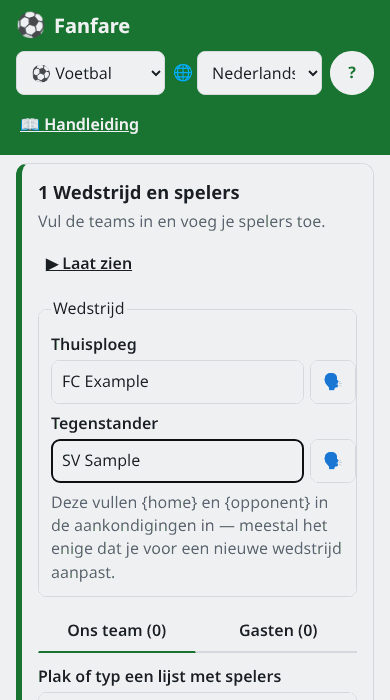
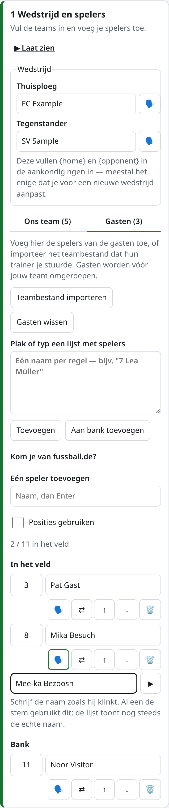
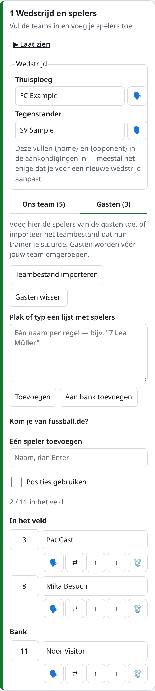
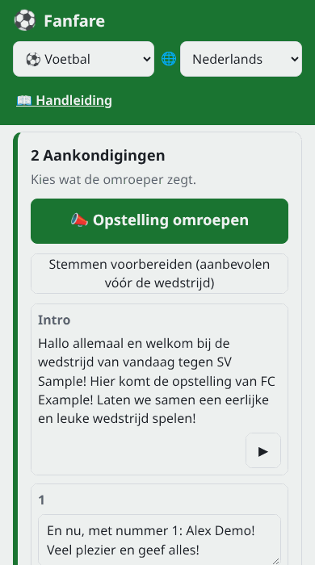
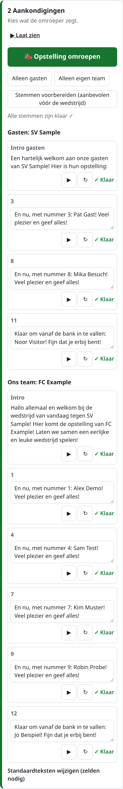
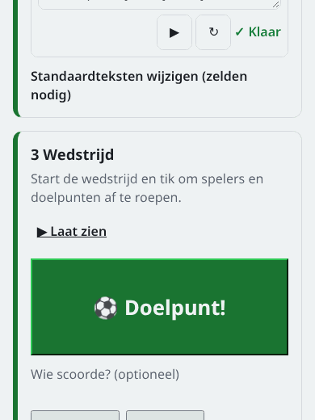
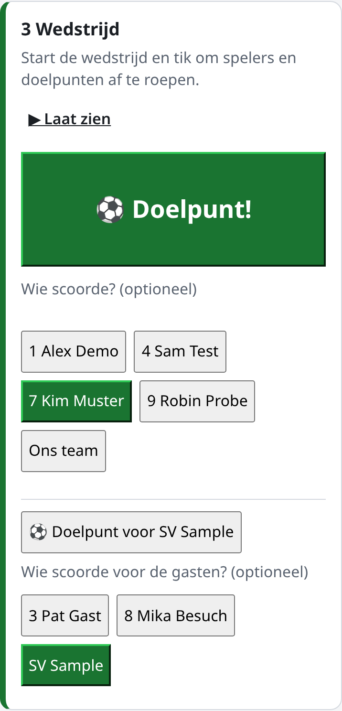
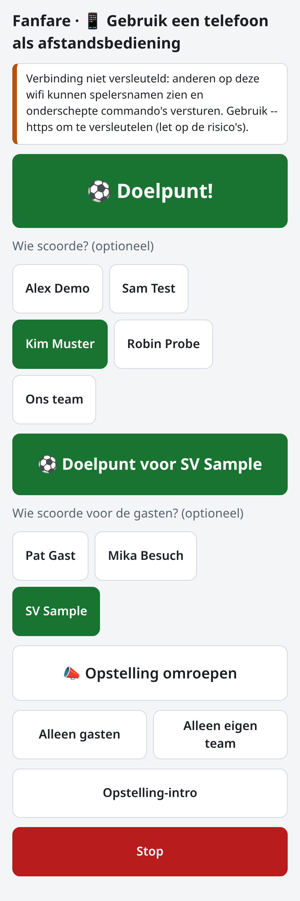
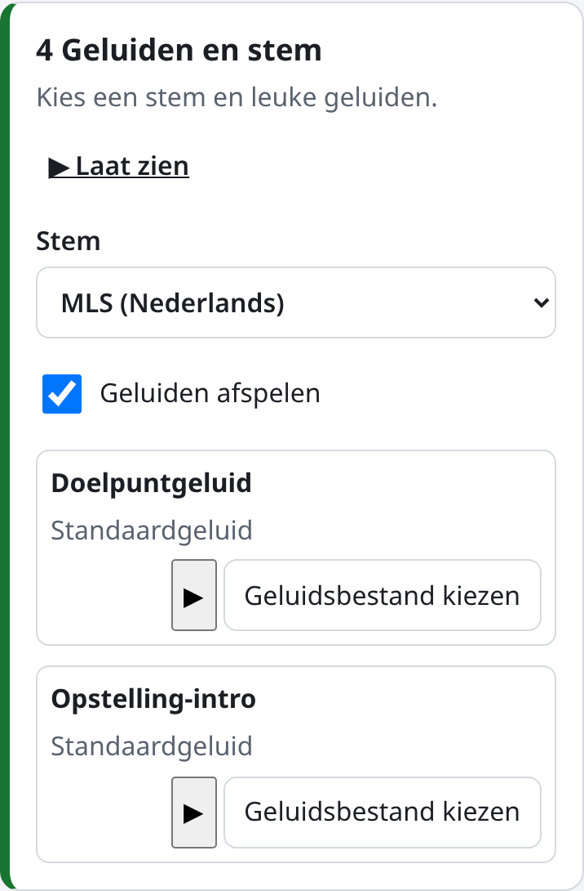
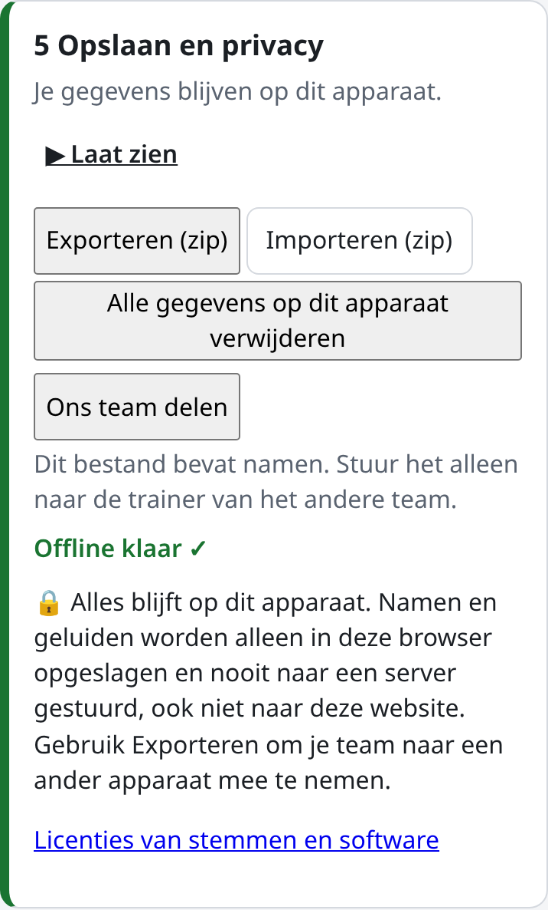

<!-- Translation: machine-assisted — native speakers, please review. -->

# Fanfare: aan de slag

Fanfare is een webpagina die je team aankondigt als een stadionomroeper. Je voert je spelers één keer in. Daarna leest een stem de opstelling voor en roept na elk doelpunt de scorer om. Het werkt in je browser, zonder account en gratis.

## 1. Wat is Fanfare?

Fanfare heeft vijf stappen onder elkaar: **1 Wedstrijd en spelers**, **2 Aankondigingen**, **3 Wedstrijd**, **4 Geluiden en stem** en **5 Opslaan en privacy**. Open de pagina op een telefoon of tablet, werk van boven naar beneden en zet het apparaat naast de luidspreker. Alles draait op je eigen apparaat. Er is geen aanmelding en geen server die je gegevens krijgt.

## 2. Vóór de eerste wedstrijd

Kies bovenaan je **Sport** en je **Taal**. De sport bepaalt het woord op de scoreknop (Doelpunt, Basket, Punt) en de posities die je kunt kiezen.

Vul in stap 1 **Thuisploeg** en **Tegenstander** in. Plak daarna je spelers in het vak **Plak of typ een lijst met spelers**, één per regel, eerst het rugnummer, bijvoorbeeld `7 Kim Muster`. Met **Toevoegen** verschijnen de spelers in de lijst **In het veld**. Met **Aan bank toevoegen** gaan wisselspelers naar de bank. Voor één naam gebruik je **Eén speler toevoegen** en druk je op Enter.

Elke rij heeft kleine knoppen: **⇄** verplaatst een speler tussen veld en bank, **↑** en **↓** wijzigen de volgorde, **🗑** verwijdert de speler (een paar seconden kun je dat ongedaan maken). Vink **Posities gebruiken** aan als de omroeper ook "Keeper" of "Middenveld" moet zeggen.

Met **🗣 Zeg het als…** bepaal je hoe een naam wordt uitgesproken. Druk in een rij op 🗣 en schrijf de naam zoals hij klinkt, bijvoorbeeld `Kim Mooster`. Alleen de stem gebruikt deze tekst. De lijst toont nog steeds de echte naam. Druk op ▶ om het te horen. Dezelfde 🗣-knop staat naast de teamnamen. **✨ Suggereren** kan een spelling voor je zoeken: kies de taal van de naam, voer de oorspronkelijke spelling in (bijvoorbeeld `Nguyễn`) en de app stelt maximaal drie spellingen voor die de stem dicht bij de echte uitspraak zegt. Druk op ▶ om ze te horen en op **Gebruiken** om er een te kiezen. Dit werkt offline; op dit moment is het beschikbaar voor Duitse en Engelse stemmen.

**Tip:** als je club fussball.de gebruikt, open daar de selectie van **je eigen team**, kopieer die en plak hem in het vak. Rugnummers en namen worden herkend. Fanfare maakt nooit verbinding met fussball.de. Meer onder "Kom je van fussball.de?" in stap 1.

**Speel je tegen een andere Fanfare-club? Wissel teambestanden uit.** Druk in stap 5 op **Ons team delen** en stuur het bestand (per e-mail of op een USB-stick) naar de trainer van het andere team. Het bestand bevat namen. Stuur het alleen naar de trainer van het andere team. Als je hun bestand krijgt, open dan in stap 1 het tabblad **Gasten**, druk op **Teambestand importeren** en kies het. De gasten verschijnen in een eigen lijst en de tegenstander wordt ingevuld. **Gasten wissen** verwijdert ze weer.

## 3. Op wedstrijddag

1. Vul in stap 1 de **Tegenstander** in. Dat is meestal het enige dat per wedstrijd verandert.

2. Open stap 2 **Aankondigingen**. Elke speler heeft een tekst die je kunt lezen, aanpassen en beluisteren met ▶. De rij **Introductie** is de welkomsttekst. Zelden nodig: met "Standaardteksten wijzigen" onderaan pas je alle teksten tegelijk aan.

3. Druk op **Stemmen voorbereiden (aanbevolen vóór de wedstrijd)** zolang je nog wifi hebt. De eerste keer wordt de stem naar je apparaat gedownload, dat duurt even. Een teller zoals `3 / 6` toont de voortgang. Wacht op **Alle stemmen zijn klaar ✓**. Daarna werkt de omroeper ook zonder internet.

4. Als de teams het veld op komen, druk je op **📣 Opstelling omroepen**. Eerst klinkt het introgeluid, dan leest de stem de opstelling voor. Met **Stop** beëindig je het op elk moment.

**Thuis voorbereiden.** Open Fanfare met wifi, druk op **Stemmen voorbereiden** en controleer of stap 5 **Offline klaar ✓** toont. Daarna werkt Fanfare op het veld ook zonder internet. Wil je de app vanaf je startscherm gebruiken (browsermenu: "App installeren" of "Toevoegen aan startscherm"): **voeg hem op iPhone en iPad eerst toe aan het startscherm**, open hem dan met wifi via het pictogram, druk op **Stemmen voorbereiden** en controleer daar **Offline klaar ✓**. Een startschermapp op iOS heeft een eigen opslag, dus wat je in Safari hebt voorbereid is daar niet beschikbaar.

**De gasten komen eerst.** Als je een gastteam hebt geïmporteerd, heet **📣 Opstelling omroepen** eerst de gasten welkom en leest hun opstelling voor, daarna die van jou. **Alleen gasten** en **Alleen eigen team** roepen maar één team om. **Stemmen voorbereiden** geldt voor beide teams. In stap 3 is er een extra knop **Doelpunt voor SV Sample** voor de doelpunten van de gasten.

## 4. Tijdens de wedstrijd

Open stap 3 **Wedstrijd**. De grote knop, bijvoorbeeld **⚽ Doelpunt!**, speelt het scoregeluid af en de stem roept het doelpunt om.

Wil je de scorer noemen, tik dan eerst op de speler onder de knop, bijvoorbeeld **7 Kim Muster**. De naam maakt dan deel uit van de aankondiging. Tik nogmaals om de keuze op te heffen, of tik op **Ons team** voor een doelpunt zonder naam. **Stop** kapt het geluid eerder af.

**Telefoon als afstandsbediening.** Als je Fanfare vanaf je laptop draait (zie „Helemaal geen internet?” in sectie 7) en het start met `--lan`, kan een telefoon op hetzelfde wifi het geluidspaneel zijn terwijl de laptop via de luidsprekers speelt. Open in stap 3 **📱 Gebruik een telefoon als afstandsbediening** en tik op **Luidspreker activeren** (één tik, zodat de laptop geluid mag afspelen). Scan de QR-code met de telefoon, of open het getoonde adres, en voer de code van 6 cijfers in. De telefoon toont grote knoppen voor het doelpunt en de scorer, de opstelling, **Stop** en het introgeluid. Het geluid komt altijd van de laptop. Er kunnen maximaal drie telefoons meedoen; nadat een telefoon is gekoppeld, toont de laptop een nieuwe code voor de volgende. **Afstandsbediening stoppen** verbreekt alle telefoons. Via gewone http is de verbinding niet versleuteld: anderen op het wifi kunnen spelersnamen zien en onderschepte commando's versturen. Start voor versleuteling met `--https` (zie de risico's in sectie 7). Met de online demo werkt dit niet.

## 5. Je eigen geluiden en stem

Open stap 4 **Geluiden en stem**. Hier kun je:

- de **Stem** kiezen (een of meer per taal),
- **Geluiden afspelen** aan- of uitzetten,
- een eigen geluid laden voor **Doelpuntgeluid** of **Opstelling-intro** met **Geluidsbestand kiezen**. Met ▶ probeer je het uit en **Standaard herstellen** brengt het origineel terug. Bestanden mogen maximaal 10 MB zijn.

**Stemmen van je eigen computer (geavanceerd).** Draait er op je computer een stemserver zoals Fanfare Studio, open dan in stap 4 **Lokale stemserver (geavanceerd)** en druk op **Verbinden**. De stemmen verschijnen dan in de stemlijst onder **Op deze computer**. Kies er een, druk op **Stemmen voorbereiden** en **Exporteren**, en importeer de zip op je telefoon: op wedstrijddag speelt de telefoon de opgeslagen clips af zonder de server. Klinkt een clip raar, druk dan in zijn rij op **↻ Opnieuw maken**. Meldt Fanfare dat de server deze website niet toestaat, dan toont het de exacte opdracht (`fanfare-studio allow …`) die je één keer op die computer uitvoert, met een knop **Commando kopiëren**. Alleen adressen op je eigen computer (localhost of 127.0.0.1) worden geaccepteerd. Fanfare Studio markeert elke clip als door AI gemaakt; controleer de licentie van een stemmodel voordat je clips buiten je club deelt.

**De eigen omroepstem van je club.** Met een verbonden stemserver kun je op **🎙 Clubstem opnemen** drukken, de korte tekst hardop voorlezen (ongeveer 15 seconden, na 20 stopt de opname vanzelf), hem met ▶ beluisteren, de stem een naam geven en het vakje voor toestemming aanvinken. Gebruik alleen je eigen stem of de stem van iemand die ermee instemt dat die voor de omroepberichten van je club wordt gebruikt, en bootst nooit bekende mensen of mensen zonder toestemming na. De opname gaat alleen naar je eigen computer en wordt door Fanfare niet bewaard, ook niet in de export. De nieuwe stem verschijnt onder **Op deze computer**. Met **🗑** verwijder je hem, inclusief zijn opname op de stemserver.

## 6. Opslaan, naar een ander apparaat, verwijderen

Open stap 5 **Opslaan en privacy**.

- **Exporteren (zip)** bewaart je team, instellingen, geluiden en de voorbereide stemclips in een bestand met een naam als `fanfare-2026-11-13.zip`.
- **Importeren (zip)** laadt zo'n bestand op een ander apparaat of na een reset. Het vervangt wat er op het apparaat staat.
- **Alle gegevens op dit apparaat verwijderen** wist alles definitief.
- Exporteer af en toe, als back-up.

**Privacy in gewone woorden:** je team, de namen en de geluiden blijven in deze browser op dit apparaat. Ze worden naar geen enkele server gestuurd, zelfs niet naar de website die Fanfare host. Er is geen tracking en geen account. De pagina praat alleen met haar eigen adres.

## 7. Problemen oplossen

- **Geen geluid op iPhone of iPad:** controleer of de stilteschakelaar uit staat en het volume hoog is. Tik één keer op de pagina of de knop en druk dan opnieuw. Het eerste geluid na het openen van de pagina heeft een tik nodig.
- **De stem downloadt traag:** de stem wordt maar één keer gedownload. Druk thuis op **Stemmen voorbereiden** met goede wifi, niet bij het veld.
- **Het team is weg na heropenen:** een privévenster kan niets opslaan. Gebruik een gewoon venster of **Exporteren (zip)** voordat je het sluit.
- **De luidspreker:** verbind een bluetooth-luidspreker of een kabel met het apparaat en test met ▶ voor de wedstrijd. Zet "Niet storen" uit.
- **Browsers:** actuele Chrome, Edge of Firefox, en Safari of iOS 16.4 of nieuwer.
- **Offline werkt niet (geen "Offline klaar ✓" in stap 5):** open Fanfare één keer met wifi, wacht even en laad de pagina opnieuw. Druk daarna op **Stemmen voorbereiden** en wacht op **Alle stemmen zijn klaar ✓**. Staat er een melding dat er een update is, druk dan tussen twee aankondigingen op **Opnieuw laden**.
- **Helemaal geen internet? Start Fanfare vanaf je laptop:** download het pakket voor jouw taal van `github.com/Lyzair/fanfare/releases` (bijvoorbeeld `fanfare-1.0.0-nl.zip`), pak het uit en dubbelklik op `start-fanfare.bat` (Windows) of `start-fanfare.command` (Mac), of start `start-fanfare.sh` (Linux). Python 3.9 of nieuwer moet geïnstalleerd zijn. Je browser opent Fanfare en na **Stemmen voorbereiden** is er geen netwerk meer nodig. Voor telefoons op hetzelfde wifi start je met `--lan` (bijvoorbeeld `./start-fanfare.sh --lan`) en open je het adres uit het venster. Dat werkt, maar via gewoon http kan een telefoon niet offline werken en de microfoon niet gebruiken. **Optioneel, met risico's:** `--lan --https` maakt op de laptop een lokale certificeringsinstantie aan nadat je `yes` hebt getypt. Open daarna één keer `<adres>/trust.html` op elke telefoon en volg de stappen (certificaat installeren; op een iPhone ook volledig vertrouwen inschakelen) en vergelijk de vingerafdruk met die in het laptopvenster. Let op: een telefoon die dit certificaat vertrouwt, vertrouwt alles wat met de sleutel van deze laptop is ondertekend (beperkt tot adressen in het lokale netwerk, maar dat omvat routers, NAS-schijven en slimme apparaten); de sleutel staat onversleuteld op de laptop, doe dit dus alleen op een computer die je vertrouwt. Verwijder het als je het niet meer nodig hebt: start met `--forget-ca` op de laptop en verwijder het certificaat in de instellingen van elke telefoon (Android: Beveiliging, Versleuteling en inloggegevens, Gebruikersgegevens; iPhone: Algemeen, VPN en apparaatbeheer). Eenvoudiger alternatieven zonder certificaat: de online demo op de telefoon, of Fanfare direct op de laptop met de luidsprekers.
- **Met Docker:** IT-kundige clubleden kunnen Fanfare ook met Docker draaien; zie `docs/self-hosting.md`. IT-kundigen kunnen ook een Raspberry Pi in het clubhuis instellen die Fanfare aanbiedt aan alle telefoons op de club-wifi: zie `deploy/raspberry-pi/README.md`; achter een bestaande reverse proxy beschrijft `docs/self-hosting.md` Caddy, Traefik en Nginx Proxy Manager.
