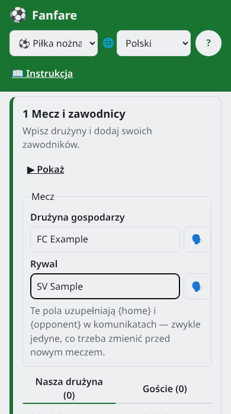
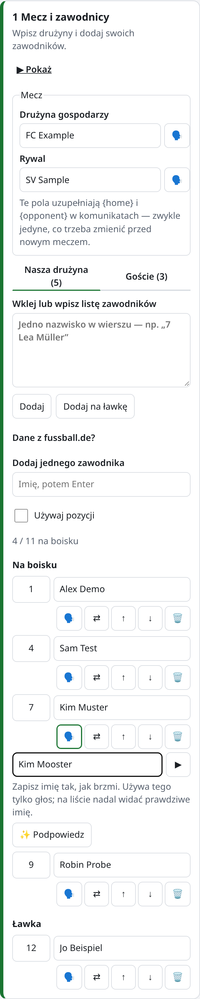
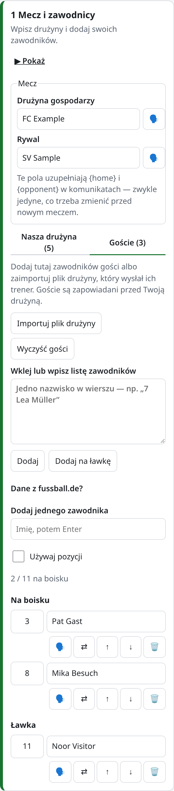
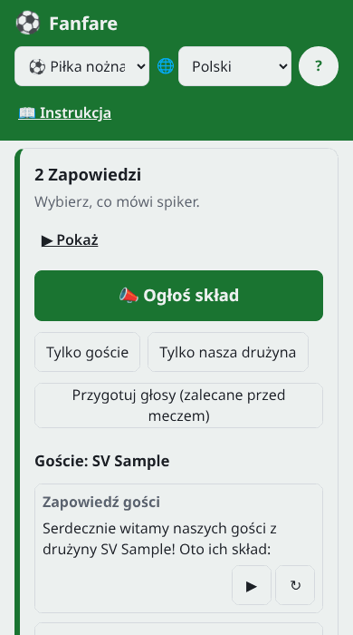
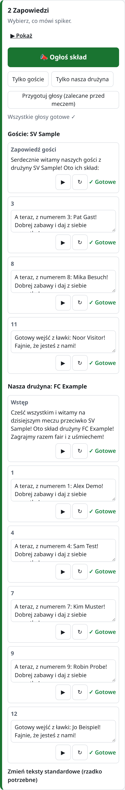
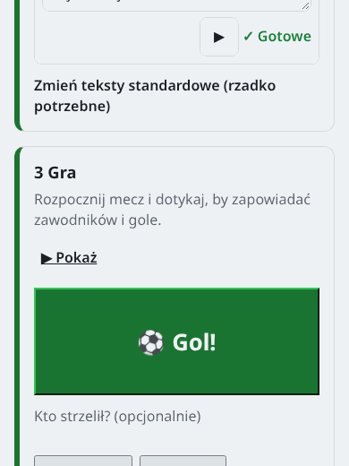
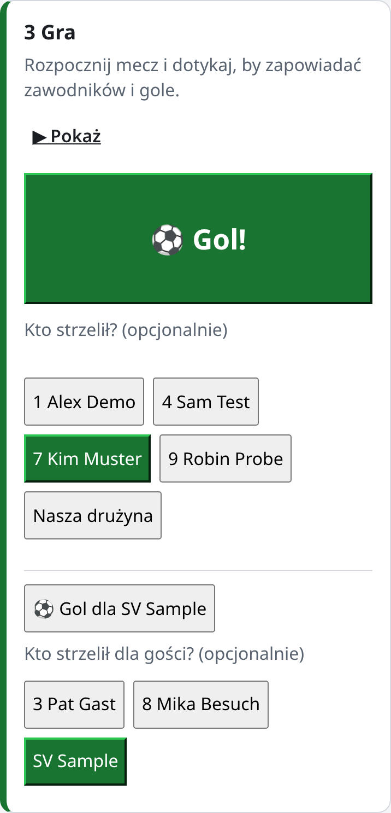
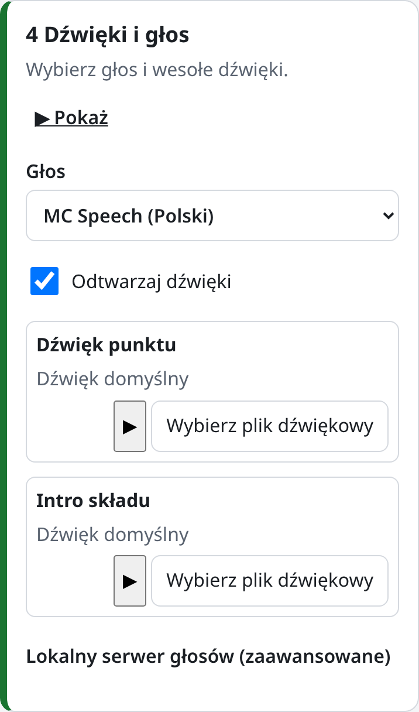
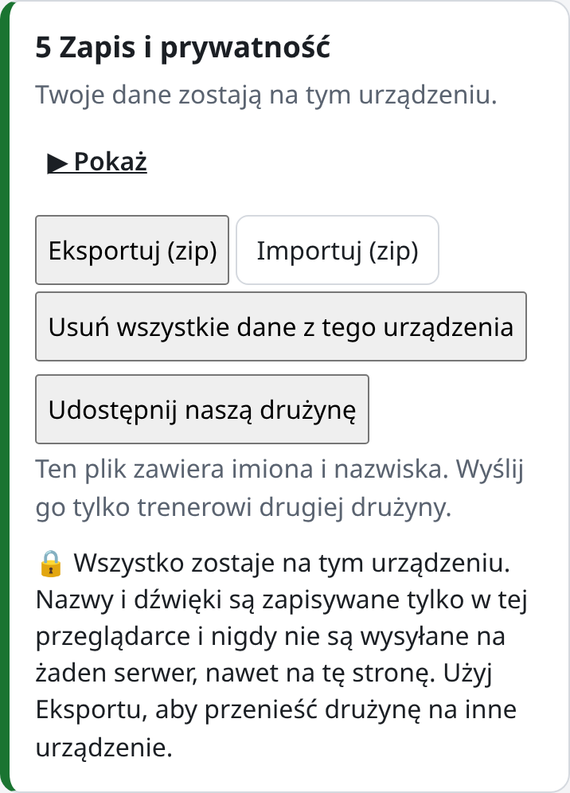

<!-- Translation: machine-assisted — native speakers, please review. -->

# Fanfare: pierwsze kroki

Fanfare to strona internetowa, która zapowiada Twoją drużynę jak spiker na stadionie. Wpisujesz zawodników raz. Potem głos odczytuje skład i po każdym golu woła strzelca. Działa w przeglądarce, bez konta i za darmo.

## 1. Czym jest Fanfare?

Fanfare ma pięć kroków jeden pod drugim: **1 Mecz i zawodnicy**, **2 Zapowiedzi**, **3 Gra**, **4 Dźwięki i głos** oraz **5 Zapis i prywatność**. Otwórz stronę na telefonie lub tablecie, idź od góry do dołu i postaw urządzenie obok głośnika. Wszystko działa na Twoim urządzeniu. Nie ma rejestracji ani serwera, który dostaje Twoje dane.

## 2. Przed pierwszym meczem

U góry wybierz **Dyscyplina** i **Język**. Dyscyplina określa słowo na przycisku wyniku (Gol, Kosz, Punkt) i dostępne pozycje.

W kroku 1 wpisz **Drużyna gospodarzy** i **Rywal**. Potem wklej zawodników w pole **Wklej lub wpisz listę zawodników**, po jednym w wierszu, najpierw numer koszulki, na przykład `7 Kim Muster`. Przyciskiem **Dodaj** zawodnicy trafiają na listę **Na boisku**. Przyciskiem **Dodaj na ławkę** rezerwowi trafiają na ławkę. Pojedyncze nazwisko wpisz w **Dodaj jednego zawodnika** i naciśnij Enter.

Każdy wiersz ma małe przyciski: **⇄** przenosi zawodnika między boiskiem a ławką, **↑** i **↓** zmieniają kolejność, **🗑** usuwa zawodnika (przez kilka sekund możesz cofnąć). Zaznacz **Używaj pozycji**, jeśli spiker ma też mówić "Bramkarz" lub "Pomocnik".

**🗣 Powiedz to jak…** ustala, jak wymawiane jest nazwisko. Naciśnij 🗣 w wierszu i zapisz nazwisko tak, jak brzmi, na przykład `Kim Mooster`. Tylko głos korzysta z tego tekstu. Lista nadal pokazuje prawdziwe nazwisko. Naciśnij ▶, aby posłuchać. Ten sam przycisk 🗣 jest obok nazw drużyn. **✨ Podpowiedz** może znaleźć pisownię za Ciebie: wybierz język nazwiska, wpisz jego oryginalną pisownię (na przykład `Nguyễn`), a aplikacja zaproponuje do trzech zapisów, które głos wymawia blisko prawdziwej wymowy. Naciśnij ▶, aby posłuchać każdego, i **Użyj**, aby go wybrać. Działa offline; na razie jest dostępne dla głosów niemieckiego i angielskiego.

**Wskazówka:** jeśli Twój klub korzysta z fussball.de, otwórz tam skład **własnej drużyny**, skopiuj go i wklej w pole. Numery i nazwiska są rozpoznawane. Fanfare nigdy nie łączy się z fussball.de. Więcej w "Dane z fussball.de?" w kroku 1.

**Grasz z innym klubem używającym Fanfare? Wymieńcie się plikami drużyn.** W kroku 5 naciśnij **Udostępnij naszą drużynę** i wyślij plik (e-mailem lub na pendrive) trenerowi drugiej drużyny. Plik zawiera imiona i nazwiska. Wyślij go tylko trenerowi drugiej drużyny. Gdy dostaniesz ich plik, otwórz w kroku 1 kartę **Goście**, naciśnij **Importuj plik drużyny** i wybierz go. Goście pojawią się na osobnej liście, a przeciwnik zostanie wpisany. **Wyczyść gości** usuwa ich ponownie.

## 3. W dniu meczu

1. W kroku 1 wpisz **Rywal**. To zwykle jedyna rzecz, która zmienia się z meczu na mecz.

2. Otwórz krok 2 **Zapowiedzi**. Każdy zawodnik ma tekst, który możesz przeczytać, zmienić i odsłuchać przyciskiem ▶. Wiersz **Wstęp** to tekst powitalny. Rzadko potrzebne: "Zmień teksty standardowe" na dole zmienia wszystkie teksty naraz.

3. Naciśnij **Przygotuj głosy (zalecane przed meczem)**, dopóki masz Wi-Fi. Za pierwszym razem głos jest pobierany na urządzenie, co chwilę trwa. Licznik, na przykład `3 / 6`, pokazuje postęp. Poczekaj na **Wszystkie głosy gotowe ✓**. Potem spiker działa także bez internetu.

4. Gdy drużyny wychodzą na boisko, naciśnij **📣 Ogłoś skład**. Najpierw gra dźwięk wstępu, potem głos odczytuje skład. **Zatrzymaj** kończy w każdej chwili.

**Przygotuj w domu.** Otwórz Fanfare z Wi-Fi, naciśnij **Przygotuj głosy** i sprawdź, czy w kroku 5 widać **Gotowe offline ✓**. Potem Fanfare działa na boisku bez internetu. Aby używać aplikacji z ekranu głównego (menu przeglądarki: „Zainstaluj aplikację” lub „Dodaj do ekranu głównego”): **na iPhonie i iPadzie najpierw dodaj ją do ekranu głównego**, potem otwórz z ikony przy włączonym Wi-Fi, naciśnij **Przygotuj głosy** i sprawdź tam **Gotowe offline ✓**. Aplikacja z ekranu głównego na iOS ma własną pamięć, więc to, co przygotowano w Safari, nie jest w niej dostępne.

**Goście są pierwsi.** Jeśli zaimportowano drużynę gości, **📣 Ogłoś skład** wita gości i odczytuje ich skład, a potem Twój. **Tylko goście** i **Tylko nasza drużyna** zapowiadają tylko jedną drużynę. **Przygotuj głosy** obejmuje obie drużyny. W kroku 3 jest dodatkowy przycisk **Gol dla SV Sample** dla goli gości.

## 4. W trakcie meczu

Otwórz krok 3 **Gra**. Duży przycisk, na przykład **⚽ Gol!**, odtwarza dźwięk gola, a głos ogłasza gola.

Aby wywołać strzelca, najpierw dotknij zawodnika pod przyciskiem, na przykład **7 Kim Muster**. Nazwisko staje się częścią zapowiedzi. Dotknij ponownie, aby odznaczyć, albo dotknij **Nasza drużyna** dla gola bez nazwiska. **Zatrzymaj** przerywa dźwięk wcześniej.

## 5. Własne dźwięki i głos

Otwórz krok 4 **Dźwięki i głos**. Tutaj możesz:

- wybrać **Głos** (jeden lub kilka na język),
- włączyć lub wyłączyć **Odtwarzaj dźwięki**,
- wczytać własny dźwięk dla **Dźwięk punktu** lub **Intro składu** przyciskiem **Wybierz plik dźwiękowy**. Przyciskiem ▶ go wypróbujesz, a **Przywróć domyślny** przywraca oryginał. Pliki mogą mieć do 10 MB.

## 6. Zapis, przenoszenie na inne urządzenie, usuwanie

Otwórz krok 5 **Zapis i prywatność**.

- **Eksportuj (zip)** zapisuje drużynę, ustawienia i dźwięki w pliku o nazwie takiej jak `fanfare-2026-11-13.zip`.
- **Importuj (zip)** wczytuje taki plik na innym urządzeniu lub po zresetowaniu. Zastępuje to, co jest na urządzeniu.
- **Usuń wszystkie dane z tego urządzenia** usuwa wszystko na stałe.
- Eksportuj od czasu do czasu, jako kopię zapasową.

**Prywatność prostymi słowami:** Twoja drużyna, nazwiska i dźwięki zostają w tej przeglądarce na tym urządzeniu. Nie są wysyłane na żaden serwer, nawet do strony, która udostępnia Fanfare. Nie ma śledzenia ani konta. Strona łączy się tylko z własnym adresem.

## 7. Rozwiązywanie problemów

- **Brak dźwięku na iPhonie lub iPadzie:** sprawdź, czy przełącznik wyciszenia z boku jest wyłączony, a głośność podniesiona. Dotknij raz strony lub przycisku, a potem naciśnij ponownie. Pierwszy dźwięk po otwarciu strony wymaga dotknięcia.
- **Pobieranie głosu jest wolne:** głos pobiera się tylko raz. Naciśnij **Przygotuj głosy** w domu przy dobrym Wi-Fi, nie na boisku.
- **Drużyna zniknęła po ponownym otwarciu:** okno prywatne nie może nic zapisać. Użyj zwykłego okna albo **Eksportuj (zip)** przed zamknięciem.
- **Głośnik:** podłącz głośnik Bluetooth lub kabel do urządzenia i przetestuj przyciskiem ▶ przed meczem. Wyłącz tryb "Nie przeszkadzać".
- **Przeglądarki:** aktualny Chrome, Edge lub Firefox oraz Safari lub iOS 16.4 albo nowszy.
- **Offline nie działa (w kroku 5 nie ma „Gotowe offline ✓”):** otwórz Fanfare raz z Wi-Fi, poczekaj chwilę i odśwież stronę. Potem naciśnij **Przygotuj głosy** i poczekaj na **Wszystkie głosy gotowe ✓**. Jeśli pojawi się informacja o aktualizacji, naciśnij **Odśwież** między zapowiedziami.
- **W ogóle bez internetu? Uruchom Fanfare z laptopa:** rozpakuj pakiet `fanfare-local` i kliknij dwukrotnie `start-fanfare.bat` (Windows) lub `start-fanfare.command` (Mac), albo uruchom `start-fanfare.sh` (Linux). Musi być zainstalowany Python 3.9 lub nowszy. Przeglądarka otworzy Fanfare, a po **Przygotuj głosy** sieć nie jest już potrzebna. Aby używać go na telefonach w tej samej sieci Wi-Fi, uruchom z opcją `--lan` (na przykład `./start-fanfare.sh --lan`) i otwórz na telefonie adres `https` pokazany w oknie. **Raz na telefon:** otwórz `<adres>/trust.html` i wykonaj opisane tam kroki (zainstaluj certyfikat; na iPhonie włącz też pełne zaufanie). Porównaj odcisk palca na telefonie z tym w oknie laptopa. Bez tego kroku telefon nie będzie działał offline ani nie użyje mikrofonu.
