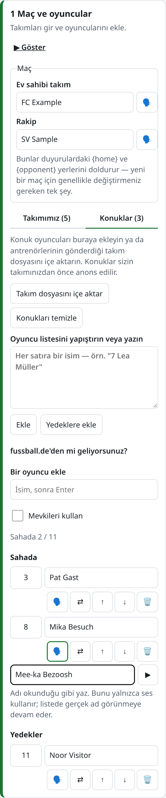
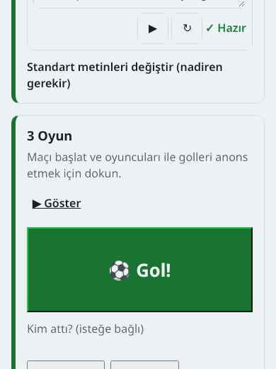

<!-- Translation: machine-assisted — native speakers, please review. -->

# Fanfare: başlangıç kılavuzu

Fanfare, takımınızı stadyum spikeri gibi duyuran bir web sayfasıdır. Oyuncularınızı bir kez girersiniz. Sonra bir ses kadroyu okur ve her golden sonra golü atanı seslenir. Tarayıcıda çalışır, hesap gerektirmez ve ücretsizdir.

## 1. Fanfare nedir?

Fanfare'in alt alta beş adımı vardır: **1 Maç ve oyuncular**, **2 Anonslar**, **3 Oyun**, **4 Sesler ve ses seçimi** ve **5 Kaydet ve gizlilik**. Sayfayı telefonda veya tablette açın, yukarıdan aşağıya ilerleyin ve cihazı hoparlörün yanına koyun. Her şey kendi cihazınızda çalışır. Kayıt yoktur ve verilerinizi alan bir sunucu yoktur.

## 2. İlk maçtan önce

Üstte **Spor** ve **Dil** seçin. Spor, skor düğmesindeki sözcüğü (Gol, Sayı, Puan) ve seçilebilen mevkileri belirler.

1. adımda **Ev sahibi takım** ve **Rakip** alanlarını doldurun. Sonra oyuncularınızı **Oyuncu listesini yapıştırın veya yazın** kutusuna yapıştırın, her satıra bir oyuncu, önce forma numarası, örneğin `7 Kim Muster`. **Ekle** ile oyuncular **Sahada** listesinde görünür. **Yedeklere ekle** ile yedekler yedek listesine gider. Tek bir isim için **Bir oyuncu ekle** alanına yazıp Enter'a basın.

Her satırda küçük düğmeler vardır: **⇄** oyuncuyu saha ile yedekler arasında taşır, **↑** ve **↓** sırayı değiştirir, **🗑** oyuncuyu siler (birkaç saniye geri alabilirsiniz). Spikerin "Kaleci" veya "Orta saha" da söylemesini istiyorsanız **Mevkileri kullan** kutusunu işaretleyin.

**🗣 Şöyle söyle…** bir ismin nasıl okunacağını belirler. Bir satırda 🗣 düğmesine basın ve ismi okunduğu gibi yazın, örneğin `Kim Mooster`. Bu metni yalnızca ses kullanır. Liste gerçek ismi göstermeye devam eder. Dinlemek için ▶ düğmesine basın. Aynı 🗣 düğmesi takım adlarının yanında da vardır.

**İpucu:** kulübünüz fussball.de kullanıyorsa orada **kendi takımınızın** kadrosunu açın, kopyalayın ve kutuya yapıştırın. Forma numaraları ve isimler tanınır. Fanfare fussball.de'ye asla bağlanmaz. Ayrıntılar için 1. adımdaki "fussball.de'den mi geliyorsunuz?" bölümüne bakın.

## 3. Maç günü

1. 1. adımda **Rakip** alanını doldurun. Maçtan maça genellikle değişen tek şey budur.

2. 2. adımı **Anonslar** açın. Her oyuncunun okuyabileceğiniz, değiştirebileceğiniz ve ▶ ile dinleyebileceğiniz bir metni vardır. **Giriş** satırı karşılama metnidir. Nadiren gerekir: en alttaki "Standart metinleri değiştir" tüm metinleri bir kerede değiştirir.

3. Wi-Fi'niz varken **Sesleri hazırla (maçtan önce önerilir)** düğmesine basın. İlk seferde ses cihazınıza indirilir, bu biraz sürer. `3 / 6` gibi bir sayaç ilerlemeyi gösterir. **Tüm sesler hazır ✓** yazısını bekleyin. Bundan sonra spiker internet olmadan da çalışır.

4. Takımlar sahaya çıkarken **📣 Kadroyu duyur** düğmesine basın. Önce giriş sesi çalar, sonra ses kadroyu okur. **Durdur** istediğiniz an bitirir.

## 4. Maç sırasında

3. adımı **Oyun** açın. Büyük düğme, örneğin **⚽ Gol!**, gol sesini çalar ve ses golü duyurur.

Golü atanı söyletmek için önce düğmenin altındaki oyuncuya dokunun, örneğin **7 Kim Muster**. İsim anonsun parçası olur. Seçimi kaldırmak için tekrar dokunun, isimsiz gol için **Takımımız** düğmesine dokunun. **Durdur** sesi erken keser.

## 5. Kendi seslerin ve sesin

4. adımı **Sesler ve ses seçimi** açın. Burada şunları yapabilirsiniz:

- **Ses** seçmek (dil başına bir veya birkaç),
- **Sesleri çal** seçeneğini açıp kapatmak,
- **Gol sesi** veya **Kadro tanıtım sesi** için **Ses dosyası seç** ile kendi sesinizi yüklemek. ▶ ile denersiniz, **Varsayılana sıfırla** orijinali geri getirir. Dosyalar en fazla 10 MB olabilir.

## 6. Kaydet, başka cihaza taşı, sil

5. adımı **Kaydet ve gizlilik** açın.

- **Dışa aktar (zip)** takımınızı, ayarlarınızı ve seslerinizi `fanfare-2026-11-13.zip` gibi adlı bir dosyaya kaydeder.
- **İçe aktar (zip)** böyle bir dosyayı başka bir cihaza veya sıfırlamadan sonra yükler. Cihazdakinin yerine geçer.
- **Bu cihazdaki tüm verileri sil** her şeyi kalıcı olarak siler.
- Yedek olarak ara sıra dışa aktarın.

**Gizlilik, sade sözlerle:** takımınız, isimler ve sesler bu cihazda, bu tarayıcıda kalır. Hiçbir sunucuya gönderilmez, Fanfare'i barındıran siteye bile. İzleme ve hesap yoktur. Sayfa yalnızca kendi adresiyle konuşur.

## 7. Sorun giderme

- **iPhone veya iPad'de ses yok:** yandaki sessiz anahtarının kapalı ve ses seviyesinin yüksek olduğunu kontrol edin. Sayfaya veya düğmeye bir kez dokunun, sonra tekrar basın. Sayfa açıldıktan sonraki ilk ses için bir dokunuş gerekir.
- **Ses indirmesi yavaş:** ses yalnızca bir kez indirilir. **Sesleri hazırla** düğmesine sahada değil, evde iyi bir Wi-Fi ile basın.
- **Yeniden açınca takım yok:** gizli pencere hiçbir şey kaydedemez. Normal pencere kullanın veya kapatmadan önce **Dışa aktar (zip)** yapın.
- **Hoparlör:** cihaza bir Bluetooth hoparlör veya kablo bağlayın ve maçtan önce ▶ ile deneyin. "Rahatsız etmeyin" modunu kapatın.
- **Tarayıcılar:** güncel Chrome, Edge veya Firefox ve Safari ya da iOS 16.4 veya daha yeni.
