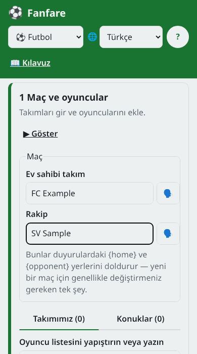
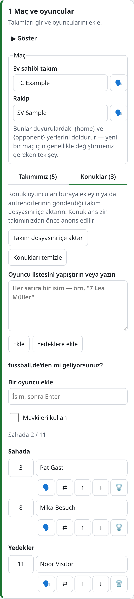
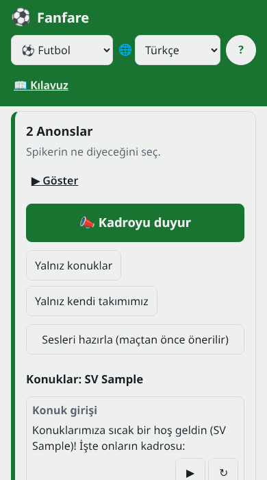
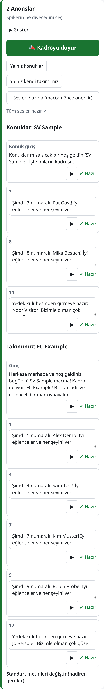
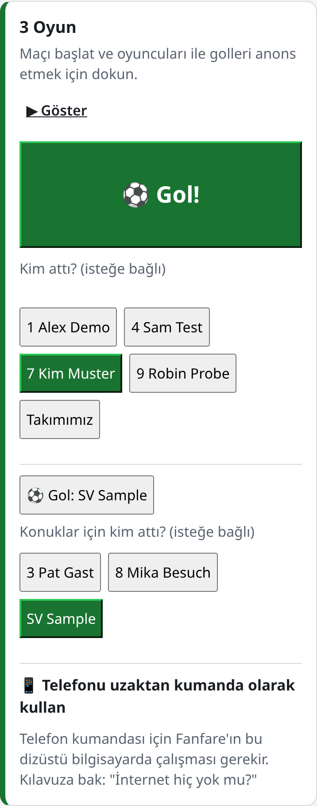
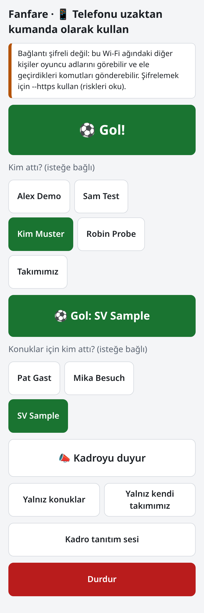
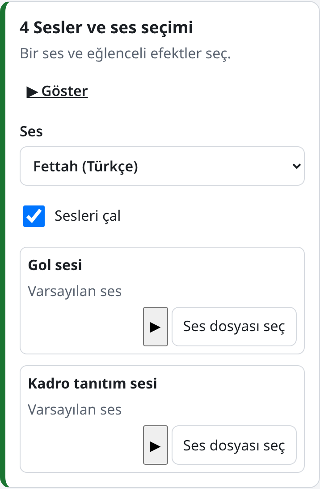
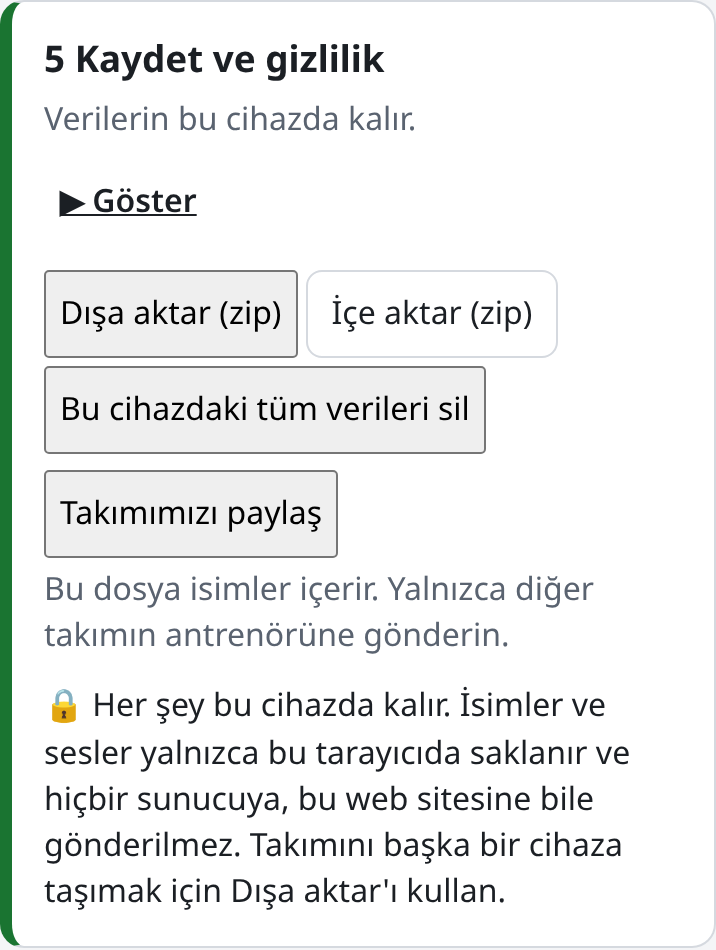

<!-- Translation: machine-assisted — native speakers, please review. -->

# Fanfare: başlangıç kılavuzu

Fanfare, takımınızı stadyum spikeri gibi duyuran bir web sayfasıdır. Oyuncularınızı bir kez girersiniz. Sonra bir ses kadroyu okur ve her golden sonra golü atanı seslenir. Tarayıcıda çalışır, hesap gerektirmez ve ücretsizdir.

## 1. Fanfare nedir?

Fanfare'in alt alta beş adımı vardır: **1 Maç ve oyuncular**, **2 Anonslar**, **3 Oyun**, **4 Sesler ve ses seçimi** ve **5 Kaydet ve gizlilik**. Sayfayı telefonda veya tablette açın, yukarıdan aşağıya ilerleyin ve cihazı hoparlörün yanına koyun. Her şey kendi cihazınızda çalışır. Kayıt yoktur ve verilerinizi alan bir sunucu yoktur.

## 2. İlk maçtan önce

Üstte **Spor** ve **Dil** seçin. Spor, skor düğmesindeki sözcüğü (Gol, Sayı, Puan) ve seçilebilen mevkileri belirler.

1. adımda **Ev sahibi takım** ve **Rakip** alanlarını doldurun. Sonra oyuncularınızı **Oyuncu listesini yapıştırın veya yazın** kutusuna yapıştırın, her satıra bir oyuncu, önce forma numarası, örneğin `7 Kim Muster`. **Ekle** ile oyuncular **Sahada** listesinde görünür. **Yedeklere ekle** ile yedekler yedek listesine gider. Tek bir isim için **Bir oyuncu ekle** alanına yazıp Enter'a basın.

Her satırda küçük düğmeler vardır: **⇄** oyuncuyu saha ile yedekler arasında taşır, **↑** ve **↓** sırayı değiştirir, **🗑** oyuncuyu siler (birkaç saniye geri alabilirsiniz). Spikerin "Kaleci" veya "Orta saha" da söylemesini istiyorsanız **Mevkileri kullan** kutusunu işaretleyin.

**🗣 Şöyle söyle…** bir ismin nasıl okunacağını belirler. Bir satırda 🗣 düğmesine basın ve ismi okunduğu gibi yazın, örneğin `Kim Mooster`. Bu metni yalnızca ses kullanır. Liste gerçek ismi göstermeye devam eder. Dinlemek için ▶ düğmesine basın. Aynı 🗣 düğmesi takım adlarının yanında da vardır. **✨ Öner** sizin için bir yazım bulabilir: ismin dilini seçin, özgün yazımını girin (örneğin `Nguyễn`); uygulama, sesin gerçek okunuşa yakın söylediği en fazla üç yazım önerir. Her birini dinlemek için ▶, seçmek için **Kullan** düğmesine basın. Çevrimdışı çalışır; şu anda Almanca ve İngilizce sesler için kullanılabilir.

**İpucu:** kulübünüz fussball.de kullanıyorsa orada **kendi takımınızın** kadrosunu açın, kopyalayın ve kutuya yapıştırın. Forma numaraları ve isimler tanınır. Fanfare fussball.de'ye asla bağlanmaz. Ayrıntılar için 1. adımdaki "fussball.de'den mi geliyorsunuz?" bölümüne bakın.

**Fanfare kullanan başka bir kulüple mi oynuyorsunuz? Takım dosyalarını değiş tokuş edin.** 5. adımda **Takımımızı paylaş** düğmesine basın ve dosyayı (e-posta ile ya da USB bellekle) diğer takımın antrenörüne gönderin. Dosya isimler içerir. Yalnızca diğer takımın antrenörüne gönderin. Onların dosyasını aldığınızda 1. adımda **Konuklar** sekmesini açın, **Takım dosyasını içe aktar** düğmesine basın ve dosyayı seçin. Konuklar kendi listesinde görünür ve rakip alanı doldurulur. **Konukları temizle** onları yeniden kaldırır.

## 3. Maç günü

1. 1. adımda **Rakip** alanını doldurun. Maçtan maça genellikle değişen tek şey budur.

2. 2. adımı **Anonslar** açın. Her oyuncunun okuyabileceğiniz, değiştirebileceğiniz ve ▶ ile dinleyebileceğiniz bir metni vardır. **Giriş** satırı karşılama metnidir. Nadiren gerekir: en alttaki "Standart metinleri değiştir" tüm metinleri bir kerede değiştirir.

3. Wi-Fi'niz varken **Sesleri hazırla (maçtan önce önerilir)** düğmesine basın. İlk seferde ses cihazınıza indirilir, bu biraz sürer. `3 / 6` gibi bir sayaç ilerlemeyi gösterir. **Tüm sesler hazır ✓** yazısını bekleyin. Bundan sonra spiker internet olmadan da çalışır.

4. Takımlar sahaya çıkarken **📣 Kadroyu duyur** düğmesine basın. Önce giriş sesi çalar, sonra ses kadroyu okur. **Durdur** istediğiniz an bitirir.

**Evde hazırla.** Fanfare'ı Wi-Fi ile aç, **Sesleri hazırla** düğmesine bas ve 5. adımda **Çevrimdışı hazır ✓** yazdığını kontrol et. Bundan sonra Fanfare sahada internetsiz de çalışır. Uygulamayı ana ekrandan kullanmak istersen (tarayıcı menüsünde: "Uygulamayı yükle" veya "Ana ekrana ekle"): **iPhone ve iPad'de önce ana ekrana ekle**, sonra simgeden Wi-Fi ile aç, **Sesleri hazırla** düğmesine bas ve orada **Çevrimdışı hazır ✓** yazısını kontrol et. iOS'ta ana ekran uygulamasının kendi depolaması vardır; Safari'de hazırladıkların onda bulunmaz.

**Önce konuklar.** Bir konuk takım içe aktardıysanız **📣 Kadroyu duyur** önce konukları karşılar ve kadrolarını okur, ardından sizinkini. **Yalnız konuklar** ve **Yalnız kendi takımımız** yalnızca bir takımı anons eder. **Sesleri hazırla** iki takımı da kapsar. 3. adımda konukların golleri için ek bir düğme vardır: **Gol: SV Sample**.

## 4. Maç sırasında

3. adımı **Oyun** açın. Büyük düğme, örneğin **⚽ Gol!**, gol sesini çalar ve ses golü duyurur.

Golü atanı söyletmek için önce düğmenin altındaki oyuncuya dokunun, örneğin **7 Kim Muster**. İsim anonsun parçası olur. Seçimi kaldırmak için tekrar dokunun, isimsiz gol için **Takımımız** düğmesine dokunun. **Durdur** sesi erken keser.

**Telefon uzaktan kumanda olarak.** Fanfare'ı dizüstü bilgisayarından (bölüm 7'deki "İnternet hiç yok mu?" kısmına bak) `--lan` ile başlatırsan, aynı Wi-Fi'deki bir telefon ses panosu olabilir; dizüstü bilgisayar ise hoparlörlerden çalar. 3. adımda **📱 Telefonu uzaktan kumanda olarak kullan** bölümünü aç ve **Hoparlörü etkinleştir**'e bas (tek dokunuş, dizüstü bilgisayarın ses çalabilmesi için). QR kodunu telefonla tara veya gösterilen adresi aç ve 6 haneli kodu gir. Telefon; gol ve gol atan, kadro, **Durdur** ve giriş sesi için büyük düğmeler gösterir. Ses her zaman dizüstü bilgisayardan gelir. En fazla üç telefon bağlanabilir; bir telefon eşleştikten sonra dizüstü bilgisayar bir sonraki için yeni bir kod gösterir. **Kumandayı bitir** tüm telefonların bağlantısını keser. Düz http üzerinde bağlantı şifreli değildir: Wi-Fi'deki diğer kişiler oyuncu adlarını görebilir ve ele geçirdikleri komutları gönderebilir. Şifreleme için `--https` ile başlat (riskler için bölüm 7'ye bak). Çevrimiçi demoyla çalışmaz.

## 5. Kendi seslerin ve sesin

4. adımı **Sesler ve ses seçimi** açın. Burada şunları yapabilirsiniz:

- **Ses** seçmek (dil başına bir veya birkaç),
- **Sesleri çal** seçeneğini açıp kapatmak,
- **Gol sesi** veya **Kadro tanıtım sesi** için **Ses dosyası seç** ile kendi sesinizi yüklemek. ▶ ile denersiniz, **Varsayılana sıfırla** orijinali geri getirir. Dosyalar en fazla 10 MB olabilir.

**Kendi bilgisayarındaki sesler (ileri düzey).** Bilgisayarında Fanfare Studio gibi bir ses sunucusu çalışıyorsa 4. adımda **Yerel ses sunucusu (ileri düzey)** bölümünü aç ve **Bağlan**'a bas. Sesleri ses listesinde **Bu bilgisayarda** başlığı altında görünür. Birini seç, **Sesleri hazırla** ve **Dışa aktar**'a bas, zip dosyasını telefonuna aktar: maç günü telefon kayıtlı klipleri sunucu olmadan çalar. Bir klip tuhaf geliyorsa satırındaki **↻ Yeniden üret**'e bas. Fanfare sunucunun bu web sitesine izin vermediğini söylerse, o bilgisayarda bir kez çalıştırman gereken tam komutu (`fanfare-studio allow …`) **Komutu kopyala** düğmesiyle birlikte gösterir. Yalnızca kendi bilgisayarındaki adresler (localhost veya 127.0.0.1) kabul edilir. Fanfare Studio her klibi yapay zekâ üretimi olarak işaretler; klipleri kulübün dışında paylaşmadan önce ses modelinin lisansını kontrol et.

**Kulübünün kendi spiker sesi.** Bağlı bir ses sunucusuyla **🎙 Kulüp sesini kaydet**'e basabilir, kısa metni yüksek sesle okuyabilir (yaklaşık 15 saniye, 20 saniyede kendiliğinden durur), ▶ ile dinleyebilir, sese bir ad verip onay kutusunu işaretleyebilirsin. Yalnızca kendi sesini ya da kulübünün anonslarında kullanılmasını kabul eden birinin sesini kullan; ünlü kişileri veya onay vermemiş kimseyi asla taklit etme. Kayıt yalnızca kendi bilgisayarına gider, Fanfare'de saklanmaz, dışa aktarmada da yer almaz. Yeni ses **Bu bilgisayarda** altında görünür. **🗑** düğmesi onu, ses sunucusundaki kaydıyla birlikte siler.

## 6. Kaydet, başka cihaza taşı, sil

5. adımı **Kaydet ve gizlilik** açın.

- **Dışa aktar (zip)** takımınızı, ayarlarınızı, seslerinizi ve hazırlanan ses kliplerini `fanfare-2026-11-13.zip` gibi adlı bir dosyaya kaydeder.
- **İçe aktar (zip)** böyle bir dosyayı başka bir cihaza veya sıfırlamadan sonra yükler. Cihazdakinin yerine geçer.
- **Bu cihazdaki tüm verileri sil** her şeyi kalıcı olarak siler.
- Yedek olarak ara sıra dışa aktarın.

**Gizlilik, sade sözlerle:** takımınız, isimler ve sesler bu cihazda, bu tarayıcıda kalır. Hiçbir sunucuya gönderilmez, Fanfare'i barındıran siteye bile. İzleme ve hesap yoktur. Sayfa yalnızca kendi adresiyle konuşur.

## 7. Sorun giderme

- **iPhone veya iPad'de ses yok:** yandaki sessiz anahtarının kapalı ve ses seviyesinin yüksek olduğunu kontrol edin. Sayfaya veya düğmeye bir kez dokunun, sonra tekrar basın. Sayfa açıldıktan sonraki ilk ses için bir dokunuş gerekir.
- **Ses indirmesi yavaş:** ses yalnızca bir kez indirilir. **Sesleri hazırla** düğmesine sahada değil, evde iyi bir Wi-Fi ile basın.
- **Yeniden açınca takım yok:** gizli pencere hiçbir şey kaydedemez. Normal pencere kullanın veya kapatmadan önce **Dışa aktar (zip)** yapın.
- **Hoparlör:** cihaza bir Bluetooth hoparlör veya kablo bağlayın ve maçtan önce ▶ ile deneyin. "Rahatsız etmeyin" modunu kapatın.
- **Tarayıcılar:** güncel Chrome, Edge veya Firefox ve Safari ya da iOS 16.4 veya daha yeni.
- **Çevrimdışı çalışmıyor (5. adımda "Çevrimdışı hazır ✓" yok):** Fanfare'ı bir kez Wi-Fi ile aç, biraz bekle ve sayfayı yenile. Sonra **Sesleri hazırla** düğmesine bas ve **Tüm sesler hazır ✓** yazısını bekle. Güncelleme olduğunu söyleyen bir ileti çıkarsa, anonslar arasında **Yenile** düğmesine bas.
- **Hiç internet yok mu? Fanfare'ı dizüstü bilgisayarından çalıştır:** `fanfare-local` paketini aç ve `start-fanfare.bat` (Windows) ya da `start-fanfare.command` (Mac) dosyasına çift tıkla; Linux'ta `start-fanfare.sh` çalıştır. Python 3.9 veya daha yenisi kurulu olmalı. Tarayıcın Fanfare'ı açar ve **Sesleri hazırla** işleminden sonra ağa gerek kalmaz. Aynı Wi-Fi'deki telefonlar için `--lan` ile başlat (örneğin `./start-fanfare.sh --lan`) ve penceredeki adresi aç. Bu çalışır, ancak düz http üzerinden telefon çevrimdışı çalışamaz ve mikrofonu kullanamaz. **İsteğe bağlı, riskli:** `--lan --https`, sen `yes` yazdıktan sonra dizüstünde yerel bir sertifika yetkilisi oluşturur. Ardından her telefonda bir kez `<adres>/trust.html` sayfasını aç, adımları izle (sertifikayı kur; iPhone'da ayrıca tam güveni aç) ve parmak izini dizüstü penceresindekiyle karşılaştır. Dikkat: bu sertifikaya güvenen bir telefon, bu dizüstünün anahtarıyla imzalanan her şeye güvenir (yerel ağ adresleriyle sınırlı, ama buna yönlendiriciler, NAS sürücüleri ve akıllı ev cihazları dahildir); anahtar dizüstünde şifrelenmeden saklanır, bu yüzden bunu yalnızca güvendiğin bir bilgisayarda yap. Artık gerekmediğinde kaldır: dizüstünde `--forget-ca` ile başlat ve sertifikayı her telefonun ayarlarından sil (Android: Güvenlik, Şifreleme ve kimlik bilgileri, Kullanıcı kimlik bilgileri; iPhone: Genel, VPN ve Aygıt Yönetimi). Sertifika gerektirmeyen daha basit seçenekler: telefonda çevrimiçi demo ya da Fanfare'ı doğrudan dizüstünde hoparlörleriyle kullanmak.
- **Docker ile:** bilgisayardan anlayan kulüp üyeleri Fanfare'ı Docker ile de çalıştırabilir; bkz. `docs/self-hosting.md`. Bilgi işlemden anlayan biri kulüp binasında bir Raspberry Pi kurup Fanfare'ı kulüp Wi-Fi'sindeki tüm telefonlara sunabilir: bkz. `deploy/raspberry-pi/README.md`; mevcut bir ters vekil sunucunun arkasında `docs/self-hosting.md` Caddy, Traefik ve Nginx Proxy Manager'ı anlatır.
