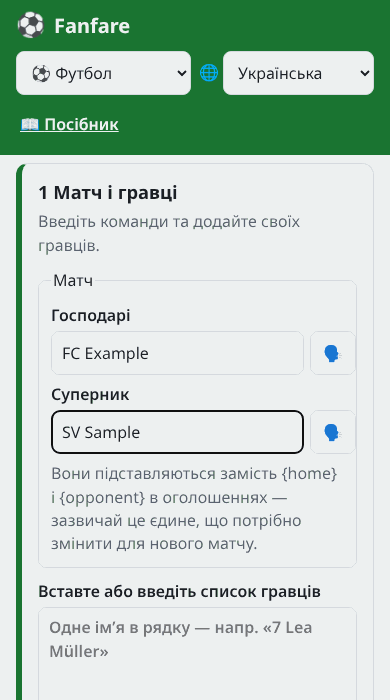
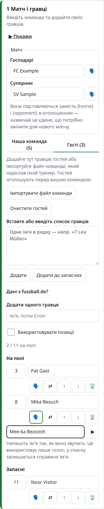
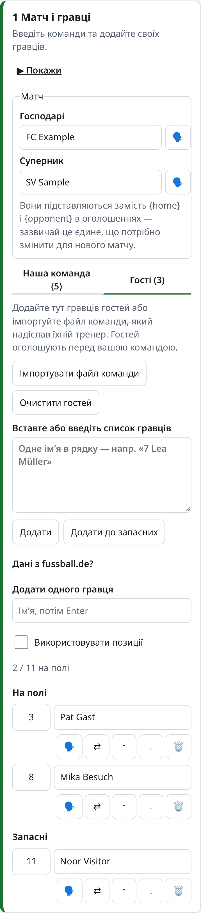
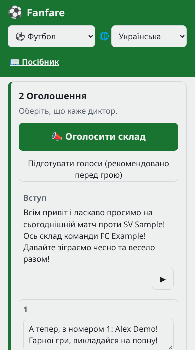
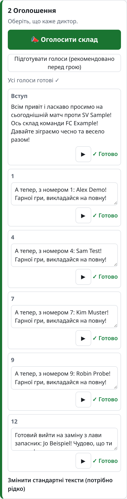
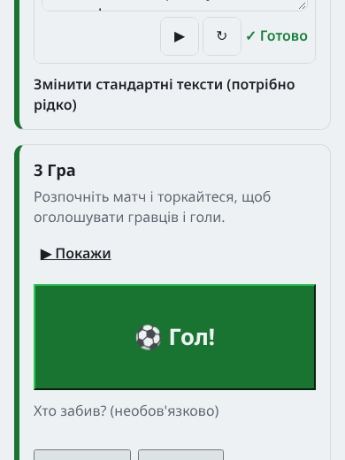
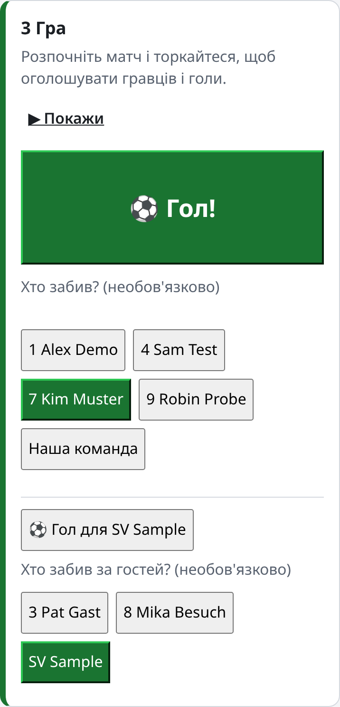
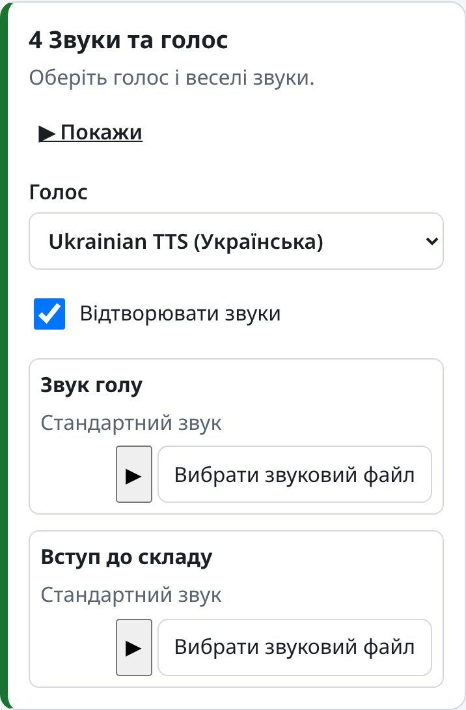
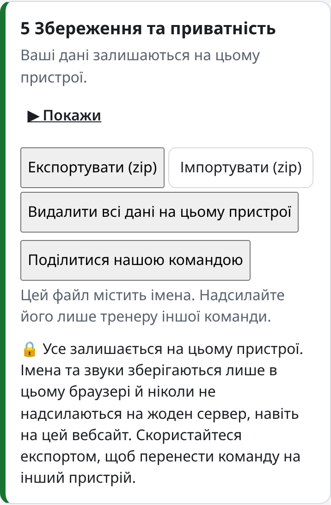

<!-- Translation: machine-assisted — native speakers, please review. -->

# Fanfare: початок роботи

Fanfare це вебсторінка, яка оголошує вашу команду, як диктор на стадіоні. Ви вносите гравців один раз. Потім голос читає склад і після кожного голу називає автора. Усе працює в браузері, без облікового запису і безкоштовно.

## 1. Що таке Fanfare?

Fanfare має п'ять кроків один під одним: **1 Матч і гравці**, **2 Оголошення**, **3 Гра**, **4 Звуки та голос** і **5 Збереження та приватність**. Відкрийте сторінку на телефоні чи планшеті, йдіть згори донизу й поставте пристрій біля гучномовця. Усе працює на вашому пристрої. Немає реєстрації та сервера, який отримує ваші дані.

## 2. Перед першим матчем

Угорі виберіть **Вид спорту** і **Мова**. Вид спорту визначає слово на кнопці рахунку (Гол, Кошик, Очко) і доступні позиції.

На кроці 1 заповніть **Господарі** та **Суперник**. Потім вставте гравців у поле **Вставте або введіть список гравців**, по одному в рядку, спочатку номер футболки, наприклад `7 Kim Muster`. Кнопка **Додати** розміщує гравців у списку **На полі**. Кнопка **Додати до запасних** відправляє запасних на лаву. Одне ім'я введіть у **Додати одного гравця** й натисніть Enter.

У кожному рядку є маленькі кнопки: **⇄** переміщує гравця між полем і лавою, **↑** та **↓** змінюють порядок, **🗑** видаляє гравця (кілька секунд можна скасувати). Позначте **Використовувати позиції**, якщо диктор має казати також "Воротар" чи "Півзахист".

**🗣 Вимовляй так…** задає, як вимовляється ім'я. Натисніть 🗣 у рядку й запишіть ім'я так, як воно звучить, наприклад `Kim Mooster`. Цей текст використовує лише голос. Список і далі показує справжнє ім'я. Натисніть ▶, щоб почути. Така сама кнопка 🗣 є біля назв команд. **✨ Підказати** може знайти написання за вас: виберіть мову імені, введіть його оригінальне написання (наприклад `Nguyễn`), і застосунок запропонує до трьох варіантів, які голос вимовляє близько до справжньої вимови. Натисніть ▶, щоб почути кожен, і **Використати**, щоб обрати його. Працює офлайн; наразі доступно для німецьких та англійських голосів.

**Порада:** якщо ваш клуб користується fussball.de, відкрийте там склад **власної команди**, скопіюйте його й вставте в поле. Номери та імена розпізнаються. Fanfare ніколи не підключається до fussball.de. Докладніше в розділі "Дані з fussball.de?" на кроці 1.

**Граєте проти іншого клубу з Fanfare? Обміняйтеся файлами команд.** На кроці 5 натисніть **Поділитися нашою командою** і надішліть файл (електронною поштою або на флешці) тренеру іншої команди. Файл містить імена. Надсилайте його лише тренеру іншої команди. Коли отримаєте їхній файл, відкрийте на кроці 1 вкладку **Гості**, натисніть **Імпортувати файл команди** і виберіть його. Гості з'являться в окремому списку, а суперника буде заповнено. **Очистити гостей** знову видаляє їх.

## 3. У день матчу

1. На кроці 1 введіть **Суперник**. Зазвичай це єдине, що змінюється від матчу до матчу.

2. Відкрийте крок 2 **Оголошення**. У кожного гравця є текст, який можна прочитати, змінити й прослухати кнопкою ▶. Рядок **Вступ** це вітальний текст. Рідко потрібно: "Змінити стандартні тексти" внизу змінює всі тексти одразу.

3. Натисніть **Підготувати голоси (рекомендовано перед грою)**, поки є Wi-Fi. Уперше голос завантажується на пристрій, це займає трохи часу. Лічильник, наприклад `3 / 6`, показує прогрес. Дочекайтеся **Усі голоси готові ✓**. Після цього диктор працює й без інтернету.

4. Коли команди виходять на поле, натисніть **📣 Оголосити склад**. Спершу звучить вступний звук, потім голос читає склад. **Стоп** завершує будь-коли.

**Підготуйся вдома.** Відкрий Fanfare один раз із Wi-Fi і натисни **Підготувати голоси**. Після цього Fanfare працює на полі й без інтернету. У кроці 5 побачиш **Готово для роботи офлайн ✓**. Можна також додати застосунок на головний екран (меню браузера: «Установити застосунок» або «Додати на головний екран»).

**Спершу гості.** Якщо ви імпортували команду гостей, **📣 Оголосити склад** вітає гостей і зачитує їхній склад, а потім ваш. **Лише гості** і **Лише наша команда** оголошують лише одну команду. **Підготувати голоси** охоплює обидві команди. На кроці 3 є додаткова кнопка **Гол для SV Sample** для голів гостей.

## 4. Під час матчу

Відкрийте крок 3 **Гра**. Велика кнопка, наприклад **⚽ Гол!**, відтворює звук голу, а голос оголошує гол.

Щоб назвати автора голу, спершу торкніться гравця під кнопкою, наприклад **7 Kim Muster**. Ім'я стане частиною оголошення. Торкніться ще раз, щоб зняти вибір, або торкніться **Наша команда** для голу без імені. **Стоп** перериває звук раніше.

## 5. Власні звуки та голос

Відкрийте крок 4 **Звуки та голос**. Тут можна:

- вибрати **Голос** (один або кілька на мову),
- увімкнути чи вимкнути **Відтворювати звуки**,
- завантажити власний звук для **Звук голу** або **Вступ до складу** кнопкою **Вибрати звуковий файл**. Кнопкою ▶ його можна випробувати, а **Скинути до стандартного** повертає оригінал. Файли можуть бути до 10 МБ.

## 6. Збереження, перенесення на інший пристрій, видалення

Відкрийте крок 5 **Збереження та приватність**.

- **Експортувати (zip)** зберігає команду, налаштування та звуки у файл із назвою на кшталт `fanfare-2026-11-13.zip`.
- **Імпортувати (zip)** завантажує такий файл на іншому пристрої або після скидання. Він замінює те, що є на пристрої.
- **Видалити всі дані на цьому пристрої** остаточно видаляє все.
- Іноді робіть експорт, як резервну копію.

**Приватність простими словами:** ваша команда, імена та звуки залишаються в цьому браузері на цьому пристрої. Їх не надсилають на жоден сервер, навіть на сайт, що розміщує Fanfare. Немає стеження й облікових записів. Сторінка звертається лише до власної адреси.

## 7. Усунення проблем

- **Немає звуку на iPhone чи iPad:** перевірте, що перемикач беззвучного режиму збоку вимкнено, а гучність збільшено. Торкніться сторінки чи кнопки один раз і натисніть знову. Перший звук після відкриття сторінки потребує дотику.
- **Голос завантажується повільно:** голос завантажується лише раз. Натисніть **Підготувати голоси** вдома з гарним Wi-Fi, а не на полі.
- **Команди немає після повторного відкриття:** приватне вікно нічого не зберігає. Використайте звичайне вікно або **Експортувати (zip)** перед закриттям.
- **Гучномовець:** підключіть Bluetooth-колонку чи кабель до пристрою та перевірте кнопкою ▶ перед матчем. Вимкніть режим "Не турбувати".
- **Браузери:** актуальні Chrome, Edge або Firefox, а також Safari чи iOS 16.4 або новіша.
- **Офлайн не працює (у кроці 5 немає «Готово для роботи офлайн ✓»):** відкрий Fanfare один раз із Wi-Fi, трохи зачекай і перезавантаж сторінку. Потім натисни **Підготувати голоси** і дочекайся **Усі голоси готові ✓**. Якщо з'явилося повідомлення про оновлення, натисни **Перезавантажити** між оголошеннями.
